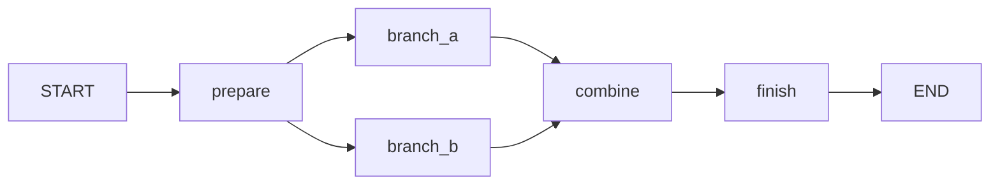

# Adaption AI Hackathon starter

A Python 3.11+ starter using the [official Adaption Python SDK](https://docs.adaptionlabs.ai/api/python). Includes a read-only dataset CLI, local environment configuration, offline tests, and GitHub Actions CI.

## Setup

Install [uv](https://docs.astral.sh/uv/getting-started/installation/), then run:

```sh
uv sync --frozen --extra dev
cp .env.example .env
```

Set `ADAPTION_API_KEY` in `.env` using your Adaption account's API key. Keep the key private; `.env` is ignored by Git. You can instead export the variable in your shell; exported values take precedence.

## Run

```sh
uv run adaption-starter --help
uv run adaption-starter list --limit 5
uv run adaption-starter get YOUR_DATASET_ID
# Equivalent module entry point:
uv run python -m adaption_starter list
```

Commands print JSON to stdout. `list` defaults to at most 20 results and follows SDK pagination only as needed. `get` needs a dataset ID accessible to your account. Errors go to stderr with a nonzero exit code. Requests use a 30-second timeout and up to two SDK retries; total elapsed time can be longer.

These commands read existing datasets; they do not create data or launch training. A real API key and network access are required to run them. Never paste keys into commits, PRs, or logs.

## Development

```sh
uv run --frozen --extra dev ruff check .
uv run --frozen --extra dev pytest
```

Tests use the installed SDK with a mocked HTTP transport and require no credentials or live API calls. CI runs the same checks on Python 3.11 and 3.12. `uv.lock` pins dependencies; after intentional dependency changes, regenerate it with `uv lock`.

The CLI lives in `src/adaption_starter/cli.py`. Use the official guide above to extend the starter with dataset creation, adaptation, asynchronous calls, or inference when your hackathon idea is ready.


## Generic LangGraph playground

This is an editable learning scaffold. It does not encode an experiment, authority
roles, a monitor, or scoring rules. Python 3.11+ is now required for the graph stack.
The existing dataset CLI remains available.

```sh
uv sync --frozen --extra dev
uv run swarm-lab --config examples/playground.json --task "Explore a workflow"
# Equivalent:
uv run python -m swarm_lab --config examples/playground.json
```

Offline mode is the default: it returns the configured placeholder strings without
credentials or API calls. These strings are fixtures, not model responses or results.

The example graph demonstrates a sequence, parallel branches, and a join:



All five nodes are placeholders you can replace, rename, remove, or extend.
`combine` waits for both branches. Branch completion order may vary.

### Read the code in this order

| File under `src/swarm_lab/` | What to learn or edit |
| --- | --- |
| `state.py` | Fields nodes can read and update; state is not automatically an LLM prompt |
| `graph.py` | Node registration and edges; change the workflow's shape here |
| `nodes.py` | Five explicit implementations; see exactly what each reads and returns |
| `backend.py` | Model boundary: offline fixtures or direct `AsyncAdaption` calls |
| `settings.py` | Model settings and instructions, optionally loaded from JSON |
| `events.py` | Append-only JSONL execution records |
| `cli.py` | CLI options, backend selection, client cleanup, run lifecycle |

A node reads state and returns a dictionary of updates. For example, `branch_a`
reads `prepared_input` and returns `branch_a_output`. LangGraph merges that update
into state. Parallel branches write different fields so their updates do not conflict.
The state can contain private application data: send only selected fields to a model.
There is no process sandbox between Python nodes.

### Add your own placeholder

1. Add a field such as `extra_output: str` to `LabState` in `state.py`.
2. Add a method to `Nodes` in `nodes.py`:

```python
def extra(self, state: LabState) -> dict:
    output = state["combined_output"]  # Replace with your processing.
    self.events.emit("node_completed", node="extra", output=output)
    return {"extra_output": output}
```

3. In `graph.py`, register `builder.add_node("extra", nodes.extra)`.
4. Replace the `combine -> finish` edge with `combine -> extra -> finish`.
5. Change `finish` to read `extra_output` if that should become the final output.

For a model node, copy the async pattern in `branch_a`, give it its own instructions,
and explicitly choose its input. For a conditional route, use LangGraph's
[conditional edges](https://docs.langchain.com/oss/python/langgraph/graph-api).
For loops, decide termination and iteration limits before adding a back edge.
Add new state fields as needed; avoid a single shared message history unless that
is deliberately part of your design.

### Live Adaption mode

Set `ADAPTION_API_KEY` in `.env` or your environment, then opt in:

```sh
uv run swarm-lab --live --config examples/playground.json --task "Explore a workflow"
```

This example makes two model requests, one per branch. They use independent
instructions/input, disable Adaption agentic memory and response storage, and do not
chain `previous_response_id`. The SDK uses a 30-second timeout and no automatic
retries. Model availability depends on your account; edit the config as needed.
Live calls may incur provider charges. The live path is covered by mocked SDK tests;
real authentication/model availability requires a live smoke test with your key.

### Logs and testing

Each run writes to a unique `runs/<id>.jsonl` by default; `--log path.jsonl` selects
a path and appends runs with distinct run IDs. Records include settings, input,
outputs, timestamps, completion, and error classes. Logs contain task/model content;
keep credentials out of prompts. `runs/` is ignored by Git. For separate processes,
use separate log files. Failed runs retain partial events and are never marked complete.

Every invocation starts with fresh graph state. This scaffold has no checkpoint
recovery or automatic retry: completed logs are execution records, not a resumable
checkpoint. Provider-internal behavior is outside this runner's control.

```sh
uv run --frozen --extra dev ruff check .
uv run --frozen --extra dev pytest
```

Tests cover the offline graph, join order, parallel input isolation, independent runs,
failure logging, settings validation, and the actual Adaption SDK request boundary
using mocked HTTP. As the research design develops, add experiment configuration,
scoring, monitor nodes, and statistical analysis separately.
