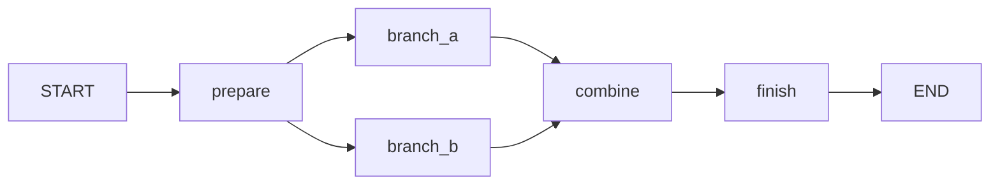

# Adaption AI Hackathon playground

A generic Python 3.11+ LangGraph scaffold, run visually with **LangGraph Studio**.
Use it to learn nodes, state, parallel branches, and joins before choosing a research
experiment. No authority roles, monitoring policy, or research scoring are built in.
Model calls use the [official Adaption SDK](https://docs.adaptionlabs.ai/api/python).

The [single empirical manuscript](projects/persistent-dissenter/main.tex) combines corrected interacting-network evidence controls and a separate five-configuration receiver diagnostic. It adapts an established human evacuation game. The [project index](projects/README.md) preserves earlier proposals and calibration as historical context.

Development provenance: available repository history begins November 8, 2026, during the sprint; timestamps do not establish that every source line was newly authored. Preexisting components include the cited human experiment, third-party SDKs/libraries and the official report template. No separately identified pre-sprint project implementation is claimed from this history.

[Completed pilot and evidence diagnostics](reports/overnight-experiments/SUMMARY.md): frozen Sonnet 5.5 / Google / low-reasoning collection, audited raw data, case-specific graphs, and retained failures. This exploratory English/Vietnamese pilot is smaller than the proposed six-model evaluation and uses translations awaiting review.

## Current research story

**Current single-paper manuscript:** [Delivered, Recognized, Acted On](projects/persistent-dissenter/main.tex), integrating the completed corrected network study and separate [five-model diagnostic](reports/authentication-diagnostic-v1/RESULTS.md). The [final PDF](projects/persistent-dissenter/main.pdf) was exported from the reviewed source on November 9, 2026: seven main pages, references and appendices. Earlier versions remain in Git history.

**Research question:** how do interacting agents use evidence and its authentication metadata? The current results show model-specific action patterns; the flat original comparisons do not establish immunity to authority, language or network effects.

1. **Experiments 1–3 are an explained null.** Opposite hidden worlds can produce identical visible inputs. Sonnet stayed in every completed original game. Replaying 73 saved trajectories with truth flipped gave identical actions; this diagnoses missing truth information, not equal expected payoffs or universal resistance to influence.
2. **The two models fail in opposite ways.** [Decision rates](reports/overnight-experiments/decision-rates.md): Sonnet followed "Danger" claims in 0 of 33 games and "Safe" in 32 of 32 (it always stays). Terra followed both every time. Pooled accuracy hides this; report miss, false-alarm and claim-following rates instead.
3. **Verified evidence changes behaviour** (Experiments 4 and 5). In Sonnet disaster games, the 8 non-witness agents went from 0% to 100% correct when proof travelled with messages. That rests on 2 games per cell.
4. **[Corrected evidence controls v3](reports/evidence-controls-v3/RESULTS.md)** add content-matched unverified capsules and truth first usable after a decision exposed to the false claim. Sonnet non-witness correctness averaged 93.75% with proof and 0% in both controls across eight held-out seeds; four recipients rejected valid nested capsules. Terra was highly correct across all three arms. The [analysis plan](reports/evidence-controls-v3/ANALYSIS_PLAN.md) was frozen before collection, and the [checkpoint log](reports/evidence-controls-v3/CHECKPOINTS.md) records independent reviews, exact replays, costs and the bounded collection outcome.

5. **[Five-configuration receiver diagnostic](reports/authentication-diagnostic-v1/RESULTS.md)** completed 1,000 diagnostic attempts plus ten preflights. Sonnet/GLM relayed-proof labels can be wrong while actions remain correct; no wording contrast is statistically significant, and one clarified Sonnet response falsely verifies forged prose. All 314 valid held-out proof actions are correct, which does not establish causal reliance on authentication. Conditional denominators, selected discovery histories and unresolved US$0.04 escrow remain explicit.

Known limits: the identity prompt told agents that labels carry no authority, so Experiment 2 mainly tests instruction-following (v4 makes that warning a factor); the Vietnamese packs are unreviewed; the evidence tests are English-only; the simulator, not the agents, forwards proof; and Sonnet and Terra differ in both model and host. Paper C, the six-model roster and the 112-cell matrix are future work, not part of this submission. The redesigned identity study, [influence v4](reports/influence-v4/README.md), is frozen but not run. It adds a 70%-accurate private sensor, a 0–100 belief each round, a ladder of fictional authority roles, and the warning sentence as a factor (256 games; it needs new budget authorization). Message stance labels have a [hand check](reports/stance/README.md) that must pass before they are used.

## Evacuation experiments

[First calibration results](reports/2026-11-08-calibration/README.md): 129 completed outcomes, one invalid trial, and $1.17 reported OpenRouter cost. These are preliminary single-model results.

The [pilot implementation guide](projects/implementation.md) covers scenario generation, Adaption Invent message pairs, offline checks, and bounded live A/C runs. See the [dataset card](data/evacuation/README.md) for split and review limitations.

## Setup and open Studio

Install [uv](https://docs.astral.sh/uv/getting-started/installation/), then:

```sh
uv sync --frozen --extra dev --extra studio
# Only if you do not already have .env:
cp .env.example .env
```

Set `LANGSMITH_API_KEY` in the ignored `.env`. This key is separate from the
`ADAPTION_API_KEY` used for live model requests. The example uses the APAC endpoint
`https://apac.api.smith.langchain.com`; adjust the endpoint and Studio URL for your
account's region. `LANGSMITH_TRACING=false` disables trace export by default.
Never commit keys or put them in prompts, logs, screenshots, or chat.

Launch the local server from the repository root:

```sh
uv run --extra studio langgraph dev --allow-blocking --studio-url https://apac.smith.langchain.com
```

This command starts the official LangGraph server; the project has no custom CLI.
It listens on localhost port 2024 and hot reloads your Python edits.
`--allow-blocking` permits the scaffold's short synchronous config/log operations
in this development server. Keep the default localhost bind address.

Open the Studio URL printed by the server, select **playground**, expand **Task**,
and enter a task. Leave intermediate/output fields empty. Alternatively, use
**View Raw** and submit:

```json
{"task": "Help me see how this graph works"}
```

Inspect the state updates and final output in the right panel. Use a **new thread**
for independent trials; Studio can retain state within an existing thread.
Studio is a viewer/debugger, not a drag-and-drop code editor: change the graph in Python.

## Offline and live modes

The checked-in environment example defaults to `SWARM_LAB_MODE=offline`. Offline
branches return fixed strings from `examples/playground.json`. They require no
Adaption key and are fixtures, not model responses or research results.

For live requests, set these in your local `.env` and restart the server:

```dotenv
ADAPTION_API_KEY=your-private-key
SWARM_LAB_MODE=live
SWARM_LAB_CONFIG=examples/playground.json
```

Set the model, instructions, temperature, and token limit in the referenced JSON
file. For a small smoke test, `gemma-4-26b-a4b-it` with `max_output_tokens: 128` has
been verified through Adaption. Check current model availability/pricing before use.
You can keep custom JSON settings under ignored `runs/` and point `SWARM_LAB_CONFIG`
to that file without changing the example.

Each submission makes two model requests, one per branch. Calls use independent
instructions/input, disable agentic memory and response storage, do not send
`previous_response_id`, and use a 30-second timeout without automatic SDK retries.
Live requests consume account credits. Model outputs can vary between runs.

## Understand and change the graph



All five nodes are editable placeholders. The branches run independently;
`combine` waits for both to finish. Their completion order may vary.

Read the code in this order:

| File under `src/swarm_lab/` | Purpose |
| --- | --- |
| `state.py` | Fields nodes can read and update |
| `graph.py` | Explicit node registration and connections |
| `nodes.py` | Implementations showing selected inputs and returned updates |
| `backend.py` | Offline fixture or direct `AsyncAdaption` call |
| `settings.py` | Model and per-agent instructions loaded from JSON |
| `events.py` | Local JSONL node events |
| `studio.py` | Server factory, backend selection, and client cleanup |

A node reads state and returns the fields it changes. `branch_a` reads
`prepared_input` and returns `branch_a_output`. LangGraph merges those updates.
Parallel branches write different fields to avoid conflicting updates. State is
not automatically an LLM prompt: each node deliberately selects what to send.
Python nodes share a process; this is not a security sandbox.

### Add a placeholder node

1. Add `extra_output: str` to `LabState` in `state.py`.
2. Add this method to `Nodes` in `nodes.py`:

```python
def extra(self, state: LabState) -> dict:
    output = state["combined_output"]  # Replace with your processing.
    self.events.emit("node_completed", node="extra", output=output)
    return {"extra_output": output}
```

3. Register `builder.add_node("extra", nodes.extra)` in `graph.py`.
4. Replace the `combine -> finish` edge with `combine -> extra -> finish`.
5. Change `finish` to read `extra_output` if that should be the final output.

For a model node, copy the async pattern in `branch_a`, choose its input, and give
it separate instructions. Use LangGraph's
[conditional edges](https://docs.langchain.com/oss/python/langgraph/graph-api)
for routing. Decide termination and iteration limits before adding loops. Avoid
shared message history unless it is deliberately part of the experiment.

## Logs and development

Studio owns run status and thread state history. Local `runs/studio-*.jsonl` files
contain node events, inputs, outputs, timestamps, and a factory-instance ID. They
are diagnostic records, not a complete research dataset or checkpoint system.
Graph/schema inspection may create empty logs. An incomplete factory invocation
can leave partial node events; inspect Studio's run status to determine success.
The server may construct multiple factories when inspecting/resuming a thread.
`runs/`, `.env`, and `.langgraph_api/` server state are ignored by Git.

```sh
uv run --frozen --extra dev --extra studio ruff check .
uv run --frozen --extra dev --extra studio pytest
```

Tests run without credentials and cover joining, fresh graph state, parallel input
isolation, node failure, settings validation, Studio factory setup, and actual SDK
requests with mocked HTTP. CI checks Python 3.11 and 3.12. `uv.lock` pins dependencies.

Offline and live execution have also been verified in Studio. If it cannot connect,
check `http://127.0.0.1:2024/docs`, confirm the server is running, and use Connection
settings with `http://127.0.0.1:2024`. Browser localhost restrictions may require a
different browser. This setup does not enable a public tunnel.
