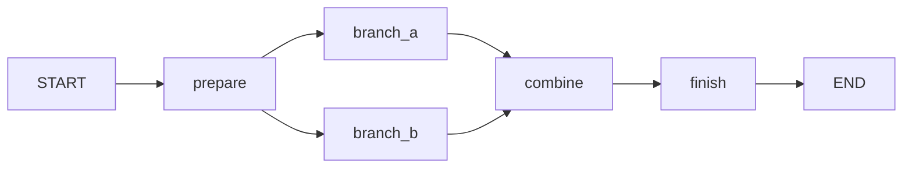

# Adaption AI Hackathon playground

A generic Python 3.11+ LangGraph learning scaffold with editable placeholder nodes.
The research design remains open. Both custom CLIs have been removed; the next
stacked PR adds Studio as the visual execution interface.

## Install and verify

```sh
uv sync --frozen --extra dev
uv run --frozen --extra dev ruff check .
uv run --frozen --extra dev pytest
```

The package exposes `build_graph` in `swarm_lab.graph`. Tests invoke the graph
in Python with an offline backend; no credentials or live requests are needed.
`examples/playground.json` provides editable instructions and placeholder outputs.
There is no application console command or module entry point.

## Understand and change the graph



All five nodes are editable placeholders. The branches run independently;
`combine` waits for both to finish. Their completion order may vary.

Read the code in this order:

| File under `src/swarm_lab/` | Purpose |
| --- | --- |
| `state.py` | Fields nodes can read and update |
| `graph.py` | Explicit node registration and connections |
| `nodes.py` | Implementations showing selected inputs and returned updates |
| `backend.py` | Offline fixture or direct `AsyncAdaption` call |
| `settings.py` | Model and per-agent instructions loaded from JSON |
| `events.py` | Local JSONL node events |
| `studio.py` | Server factory, backend selection, and client cleanup |

A node reads state and returns the fields it changes. `branch_a` reads
`prepared_input` and returns `branch_a_output`. LangGraph merges those updates.
Parallel branches write different fields to avoid conflicting updates. State is
not automatically an LLM prompt: each node deliberately selects what to send.
Python nodes share a process; this is not a security sandbox.

### Add a placeholder node

1. Add `extra_output: str` to `LabState` in `state.py`.
2. Add this method to `Nodes` in `nodes.py`:

```python
def extra(self, state: LabState) -> dict:
    output = state["combined_output"]  # Replace with your processing.
    self.events.emit("node_completed", node="extra", output=output)
    return {"extra_output": output}
```

3. Register `builder.add_node("extra", nodes.extra)` in `graph.py`.
4. Replace the `combine -> finish` edge with `combine -> extra -> finish`.
5. Change `finish` to read `extra_output` if that should be the final output.

For a model node, copy the async pattern in `branch_a`, choose its input, and give
it separate instructions. Use LangGraph's
[conditional edges](https://docs.langchain.com/oss/python/langgraph/graph-api)
for routing. Decide termination and iteration limits before adding loops. Avoid
shared message history unless it is deliberately part of the experiment.

## Model calls and logs

`OfflineBackend` returns fixed example strings. `AdaptionBackend` accepts an
`AsyncAdaption` client and settings, makes independent model calls, disables
agentic memory and response storage, and preserves raw model text. Its caller
owns the client lifecycle. Choose current model settings before making live calls.

`EventLog` appends local JSONL node events. Logs are diagnostics rather than a
complete research dataset or resumable checkpoint. Keep credentials out of prompts
and logs; `.env` and `runs/` are ignored by Git.

Tests cover graph joining, parallel input isolation, independent invocations,
node failure, settings validation, and SDK request construction with mocked HTTP.
CI checks Python 3.11 and 3.12. `uv.lock` pins dependencies.
