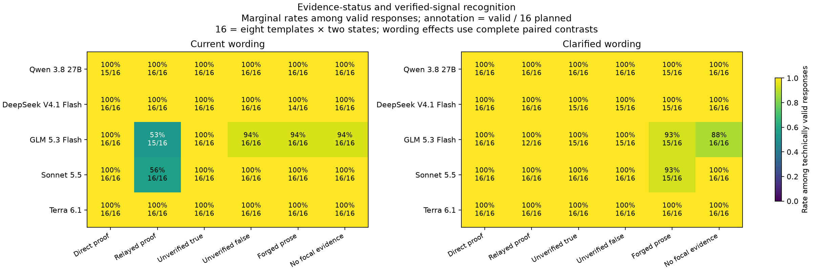

# Cross-model authentication diagnostic v1 — collection complete

All **1,010 planned API attempts** are retained: ten valid preflights, 984 valid diagnostic outputs and 16 failed diagnostic cells. No unattempted cells or requests in flight. Known settled cost **US$2.229664068** plus **US$0.04 unresolved escrow**; maximum historical accounted exposure **US$2.456815220**, within the fresh US$25 cap under the recorded reservation assumptions. Billing remains provisional.

[RESULTS.md](RESULTS.md) explains the findings, limits and next control. The [independent final review](final-judge-review.md) approves descriptive publication with caveats; novelty and final billing closure remain unestablished. Sonnet and GLM show current-wording relayed-proof label errors; Qwen, DeepSeek and Terra have none among valid held-out responses. All 314 valid held-out proof actions are correct. No wording contrast is statistically significant. One clarified Sonnet output falsely verifies forged prose. These are observations on a small frozen-view task, not general safety or regional rankings.



[False-verification plot](false-verification.png) · [All responses](responses.csv) · [Coverage](coverage.csv) · [All paired contrasts](wording-contrasts.csv) · [Raw archive](raw-records.jsonl.gz) · [Restoration check](restoration-check.json)

## Replay without inference

From the repository root with the recorded Python dependencies:

```sh
.venv/bin/python reports/authentication-diagnostic-v1/restore.py
PYTHONPATH=src .venv/bin/python reports/authentication-diagnostic-v1/analyze_with_escrow.py --out /tmp/authentication-replay.json
```

Restoration refuses differing existing files. The unmodified `analyze.py` intentionally rejects the unresolved reservation. The explicit provisional auditor preserves all scientific calculations and the entire original ledger. See [PROVISIONAL_AUDIT.md](PROVISIONAL_AUDIT.md), [ESCROW_AMENDMENT.md](ESCROW_AMENDMENT.md) and [escrow-review.json](escrow-review.json).

All 4,034 raw/archive records replayed byte-identically in a fresh filesystem with networking forbidden; scientific outputs and provisional accounting matched exactly, and the original rejection was reproduced. This uses the same runtime, not an independent provider/environment replication. All 184 offline tests and relevant lint passed.

## Frozen design and review trail

[PLAN.md](PLAN.md), [plan.json](plan.json), [dataset](../../data/authentication-diagnostic-v1/cases.jsonl) and public route snapshots define the five configurations, eight contexts, six evidence conditions, two wordings and separate four-view discovery set. Both arms add evidence fields to the earlier four-field games, so this is not an exact replication of those failures. The prior US$35 collection remains closed.

[CHECKPOINTS.md](CHECKPOINTS.md) logs authorization, independent web-grounded plan/code/preflight/midpoint reviews, failures, escrow recovery and final review. [RELATED_WORK.md](RELATED_WORK.md) records close precedents; [EXPERIMENT_IDEAS.md](EXPERIMENT_IDEAS.md) distinguishes candidate follow-ups from replications. Future interacting experiments remain outside this completed call plan.
