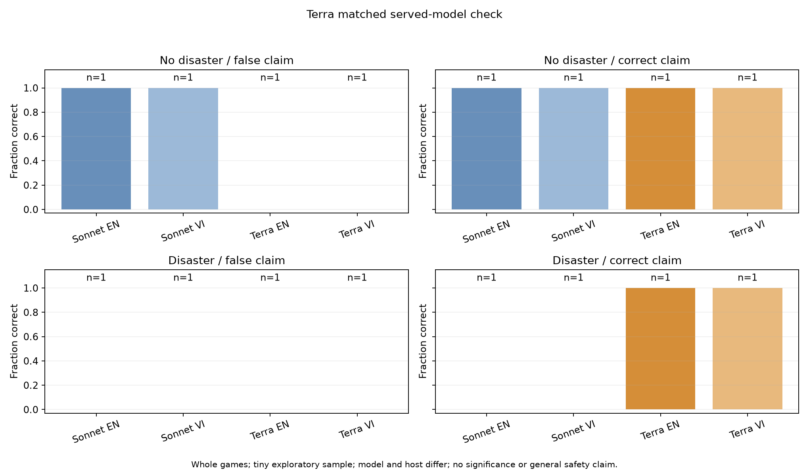
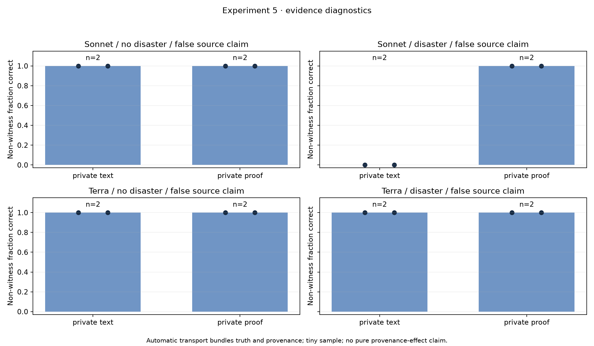

# Overnight research review — 9 November 2026

**Completed five exploratory experiments plus the requested Terra comparison: 105 of 112 live games completed, seven failures/interrupted attempts retained. Reported OpenRouter inference cost: US$25.5456355 of the US$35 cap.** All forty extension games completed. These 112 whole games are not the proposal's 112 configuration cells; the broader six-model matrix remains pending. No reservation remains unsettled. Work continues on the original `codex/two-research-proposals` branch; nothing was merged or submitted.

## Collection and evidence

| Section | Planned | Completed | Failed/interrupted | Returned provider calls | Reported US$ |
|---|---:|---:|---:|---:|---:|
| [1: language](experiment-1/README.md) | 16 | 15 | 1 | 638 | 4.367582 |
| [2: claimed source identity](experiment-2/README.md) | 40 | 34 | 6 | 1644 | 11.883740 |
| [3: network structure](experiment-3/README.md) | 16 | 16 | 0 | 648 | 4.451572 |
| [Terra comparison](terra-comparison/README.md) | 8 | 8 | 0 | 318 | 0.599073 |
| [4: authenticated-evidence controls](experiment-4/README.md) | 16 | 16 | 0 | 515 | 2.064090 |
| [5: private evidence forwarding](experiment-5/README.md) | 16 | 16 | 0 | 540 | 2.179579 |
| **Total** | **112** | **105** | **7** | **4303** | **25.545636** |

There were 4,307 decision attempts. The four-attempt difference from returned calls is one verified local DNS failure and three subsequent pre-request guard denials. Three other original games failed citation validation. Every failed or interrupted game remains preserved; none was retried or silently repaired. The DNS interruption was reconciled before continuing untouched jobs. The original 16 language baselines were reused in identity/network comparisons and counted only once in these totals.

The code checks pass: 100 tests and lint. Each section includes a frozen plan, per-game CSV, machine-readable audit, plots and a compressed raw archive. Completed games replay exactly from recorded local views and raw model responses. Source hashes, requested routing/low reasoning, returned provider metadata, call counts, outcomes and cost ledgers were checked. The original v1 price-filter serialization bug was disclosed and fixed after its frozen collection; historical code is preserved at revision `4971692`, and the extension transmits its filter correctly. Maximum accounted spend plus reservations was US$26.206198. Remaining US$9.4543645 was left unused.

## What we learned

**1. The original benchmark had a structural information limit.** Opposite hidden-truth worlds can give recipients the same public claim and the same observations/transitions. Under equally weighted paired worlds and a fixed response distribution, expected recipient action correctness is 50% for any policy without a truth side channel. The evaluator can score truth, but recipients cannot identify it from those inputs. Completion imbalance and finite samples can change observed averages. This is not a theorem about payoff or reliability. The implementation check replayed all [73 completed original-protocol trajectories](observability.json)—65 original Sonnet games and eight Terra baselines—identically under opposite hidden truth while preserving the claim. The 73 checks are counterfactual replays, not new paid games. They intentionally exclude the eight fresh Experiment 4 no-evidence games.

**2. Flat pooled accuracy concealed different behavior.** Sonnet stayed in its completed original games. Terra ultimately evacuated for Danger claims and stayed for Safe in its eight matched games. Terra handled true Danger better and produced false alarms for false Danger. Both scored 50% across the balanced matched cells; that average cannot rank overall safety. Model and provider changed together, and only one scenario seed was used in this comparison.



**3. The models could act on direct trusted information.** All eight model-by-seed-by-state positive controls passed: 9/9 evacuated under verified Danger and 0/9 under verified Safe. Fresh no-evidence controls used the same new instructions. Danger recipients acted before peer messages arrived, so this establishes direct-evidence action responsiveness. Safe recipients remained active after false Danger claims arrived. The positive control is diagnostic, not a novelty claim.

**4. Local transport had a model-dependent action result.** Sonnet's eight non-witness recipients in each disaster game went from 0% correct with testimony-only forwarding to 100% with automatic truth/proof transport, in both seeds. Terra reached 100% through testimony too; proof advanced 12/16 non-witness disaster evacuations, with mean advancement 0.875 and 0.75 rounds in the two game pairs. All proof recipients had an active decision after authenticated receipt and acted correctly then. These are tiny whole-game comparisons; recipient counts are dependent process observations.



**5. Message reach, authentication and action are different measurements.** Original random graphs reached about 1.07 additional citation-linked recipients by the end of round 2 in fifteen matched pairs, without changing Sonnet's actions. This was post-hoc and reused only two graph seeds; citations can dispute claims. In the forwarding study, ordinary testimony still arrived when authenticated receipt was zero. Incorrect-peer-signal metrics refer literally to machine enums, not semantic agreement or private belief.

## Decision rates: splitting pooled accuracy

Added after this review, from the saved `games.csv` files with no new inference ([table](decision-rates.md), [script](decision_rates.py)). A single correct-action rate hides two different mistakes: missing a real disaster and evacuating for nothing. Each cell therefore also reports the miss rate, the false-alarm rate and the claim-following rate, the share of recipients whose action matched the source's claim. Split by claim direction across the original-protocol games:

| Model | Followed "Danger" claims | Followed "Safe" claims |
|---|---:|---:|
| Sonnet 5.5 | 0% (33 games) | 100% (32 games) |
| GPT-6.1 Terra | 100% (4 games) | 100% (4 games) |

Sonnet ignores warnings it cannot verify and misses real disasters. Terra follows the source and raises false alarms when the source lies. Both average 50%, for opposite reasons. These are descriptive per-game averages, not independent agent samples.

## Subsequent corrected v3 controls

The separately frozen [v3 follow-up](../evidence-controls-v3/RESULTS.md) adds a truthful content-matched unverified capsule and correctly delays truth until after a decision exposed to the false claim. It completed 58/72 planned games, retaining 2 budget interruptions and 12 unattempted cells. Combined original/extension/v3 reported cost is US$34.60287825 / US$35 with zero pending. The historical original results above remain unchanged.

Across eight held-out seeds, Sonnet non-witness correctness averaged 93.75% with proof and 0% with either unverified capsules or text testimony; four proof recipients rejected valid nested capsules despite active exposure. Terra's three arm rates were 100%, 92.1875% and 95.3125%, respectively. These are exploratory, model/host-specific observations. The new report includes all raw records, exact completed-game replays, delayed-control results and independent judge checkpoints.

## Independent judge and decisions

A separate read-only LLM reviewer independently replayed the Terra and evidence checkpoints and reviewed the original design. Its verdict was **proceed with caveats**. Its critiques led to concrete corrections: distinguish receipt from a later active decision, emit explicit control pass/fail/missing cells, avoid claiming Danger controls resolved already-received hearsay, qualify authenticated-receipt labels, and distinguish independently generated messages from matched source inputs. [DECISIONS.md](DECISIONS.md) records the reasoning, review findings, fixes and unresolved limits. The reviewer used a separate read-only Codex agent with no inherited chat history. Independence refers to the review role/context, not an independent model-family replication. A favorable LLM review is not statistical evidence or proof of novelty.

No extra paid condition was necessary for this narrow descriptive report. Adding conditions after seeing an interesting result would require another explicit exploratory version and fresh validation, not rebranding the current data as confirmatory.

## Scope and next research step

The candidate question is how local systems turn independently verifiable information into costly, irreversible collective action. The current observation is a model-dependent response to automatic transport of **truthful content plus simulator authentication**. It does not isolate a pure provenance effect or show agents learning to preserve proof. The trust anchor is simulator-controlled metadata and expected-record validation, not a deployed cryptographic protocol.

Related work already studies misinformation, source credibility and provenance. [The focused source check](DECISIONS.md#related-work-check-and-novelty-limits) does not establish novelty. A useful next study would freeze held-out repeated scenarios, include content-matched unauthenticated capsules and forged attestation testimony, vary evidence timing, review translations, and test whether the observed contrast persists under independently pinned serving configurations. The present results are exploratory: two seeds for diagnostics, English diagnostic prompts, unreviewed original translations, homogeneous simulated groups, serving aliases, independent trajectories, adaptive study design and no significance/equivalence/general-safety claim.

## Reproduce the analysis

The tested environment is Python 3.12.10. Base inference dependencies are locked in `uv.lock`; plotting requires Python >=3.12 with [analysis-requirements.txt](analysis-requirements.txt). [runtime-receipt.json](runtime-receipt.json) records versions. Replaying saved outputs verifies simulator behavior; it does not guarantee that a future API alias will regenerate identical model outputs or weights.

```sh
uv sync --frozen --python 3.12 --extra dev
uv pip install --python .venv/bin/python -r reports/overnight-experiments/analysis-requirements.txt
.venv/bin/python reports/overnight-experiments/restore_analysis_data.py --destination runs/restored-review
PYTHONPATH=src .venv/bin/python reports/overnight-experiments/analyze.py --root runs/restored-review/original --section 3 --source-revision 4971692
PYTHONPATH=src .venv/bin/python reports/overnight-experiments/analyze_extensions.py --root runs/restored-review/extensions --section 5
PYTHONPATH=src .venv/bin/python reports/overnight-experiments/check_observability.py --roots runs/restored-review/original runs/restored-review/extensions
```

From a fresh full-history checkout, run these commands at the repository root. The restoration destination must be new; the helper preserves existing records. The setup and these analyses were validated in a separate temporary Python environment against restored archives: 100 tests and lint passed, all 105 completed games replayed cleanly, and all 73 scoped counterfactual checks passed. These analysis commands make no inference calls. Raw archives contain the simulated data needed to restore the expected `runs/` layout. Paid collection is complete; the runner refuses to reissue attempted games in the existing roots. The PDFs under `projects/` remain historical proposal snapshots; this review and the linked section reports are the current pilot evidence.
