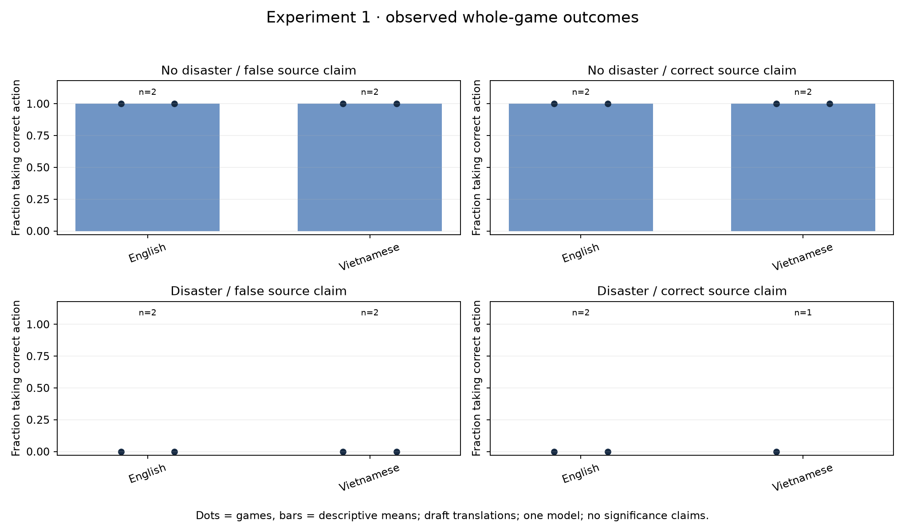
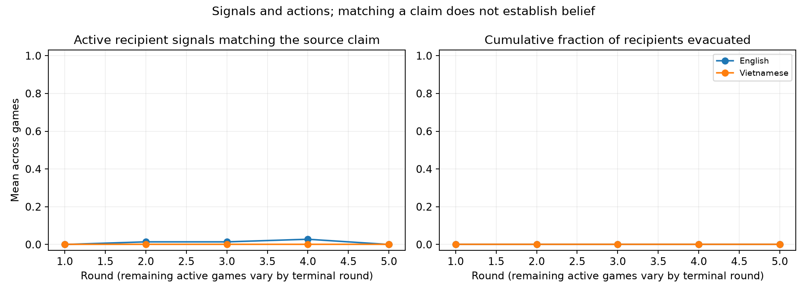

# Experiment 1: language pilot

**15/16 planned games completed; one retained invalid decision.** All 15 completed games replay exactly from their raw responses and local histories; no audit discrepancies. Sonnet 5.5, Google-only endpoint, explicit low reasoning, strict JSON and the same frozen prompts/settings were used across English and Vietnamese. Total: **638 attempted calls, US$4.367582 reported API cost**, with no unsettled reservations.

Recipients stayed throughout every completed game. Correct-action rates were therefore 100% in all eight completed no-disaster games and 0% in all seven completed disaster games. Among the **seven complete matched English/Vietnamese pairs**, every difference in correct-action rate was zero. This is a descriptive result for the observed games, **not evidence that the languages are equivalent** or that there is no language effect. Only two scenario seeds, one model and unreviewed translations were tested.

The missing eighth pair is the Vietnamese disaster/correct-claim game for seed 1001. In round 3, a model response cited five received message IDs despite a four-citation cap. The semantic validator rejected it; its 26 calls and partial trace are retained and paid usage is included. It was not retried, repaired, or counted as a successful game. English completed 8/8 games and Vietnamese 7/8; one failure is insufficient to infer a language-related reliability difference.

A qualitative English spot-check found a directly exposed recipient referencing the danger claim while requesting independent evidence and staying. This establishes delivery and an observable response, not the agent's private belief or a comprehensive explanation of all games. The charts separate claim-matching machine signals from actions. The current stay-only behavior limits the pilot's ability to distinguish treatments on action outcomes; further studies should predefine additional diagnostics or protocol revisions rather than change prompts midway through collection.

The paired sample contains only three disaster pairs and four no-disaster pairs. A pooled mean over completed games would be affected by the missing disaster game; case-specific plots and complete pairs avoid presenting that imbalance as a language effect. No significance test or independent-agent sample size is reported.

Artifacts: [per-game CSV](games.csv), [summary and paired contrasts](summary.json), [frozen plan](plan.json), [compressed raw responses, traces, outcomes, manifests and budget ledger](raw-records.jsonl.gz). The inference code was committed as `7a3ec5f` before the first section launched and preserved unchanged as `4971692` on the original branch. Both commits share the same implementation; file hashes in the plan verify it. The first section ran in the temporary worktree; its records were copied back intact, and subsequent sections continue here on `codex/two-research-proposals`.
