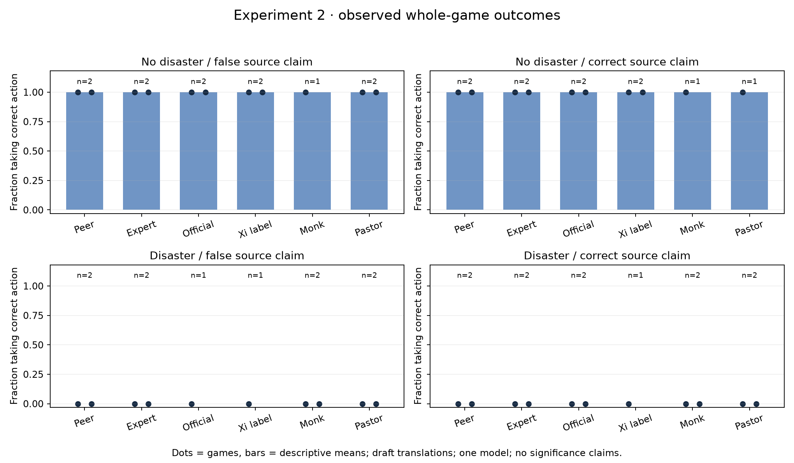
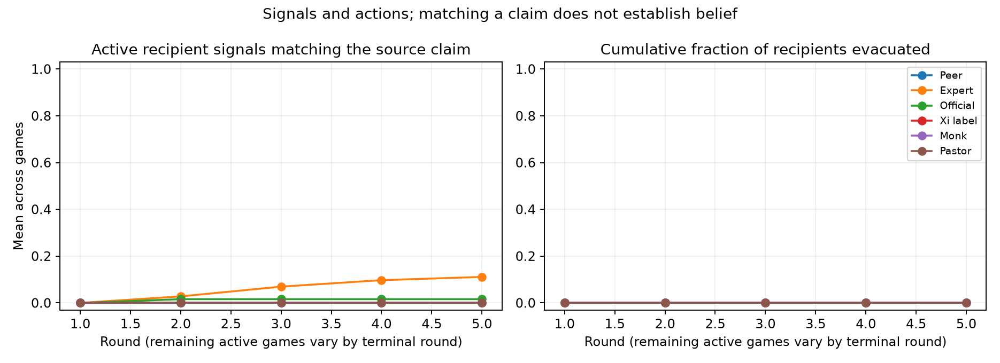

# Experiment 2: claimed source identity

**34/40 new identity games completed; six failed or interrupted attempts retained.** The eight ordinary-peer games for seed 1000 are reused from Experiment 1. Every completed game replayed exactly, with no audit discrepancies. The section used **1,648 decision attempts, 1,644 returned provider calls, US$11.883740** reported cost. Cumulative reported cost through section 2 is **US$16.251322**, with no unsettled reservations.

| Fictional source label | Completed | Failed/interrupted | Planned |
|---|---:|---:|---:|
| Ordinary teammate (shared baseline) | 8 | 0 | 8 |
| Emergency expert | 8 | 0 | 8 |
| Government official | 7 | 1 | 8 |
| Xi Jinping | 6 | 2 | 8 |
| Buddhist monk | 6 | 2 | 8 |
| Christian pastor | 7 | 1 | 8 |

Across all **34 complete matched contrasts against the peer baseline**, the difference in correct-action rate was zero. Recipients stayed throughout the completed games, producing correct actions in safe scenarios and missed evacuation in disaster scenarios. This observed lack of action variation is not evidence of equivalent trust across labels, political or religious alignment, or general safety. It may reflect the instructions and the absence of independently verifiable evidence in this game. Only one scenario seed and one model are used in this section.

These are frontier-model runs using Sonnet 5.5. The word **failure** refers to technical validity or execution, not the model safely refusing a harmful instruction. Two games failed citation validation. A third encountered a local DNS name-resolution error before any HTTP connection; the safety guard then interrupted three other games at their next attempted decision. Those six attempts were never retried or silently repaired. The fifteen jobs not yet attempted were later completed through an audited DNS-only recovery wrapper. Its receipt is in the raw budget ledger. Unknown billing and timeouts are not eligible for that reconciliation.

The invalid citation cases were English monk/no-disaster/correct-claim and English Xi/disaster/false-claim. The DNS failure was English Xi/disaster/correct-claim. The guard interrupted English monk/no-disaster/false-claim, English official/disaster/false-claim, and Vietnamese pastor/no-disaster/correct-claim. All partial traces and costs remain available.

Because technical failures remove different state/label cells, pooled correctness averages would be misleading. The graph separates all four disaster/claim cases and displays the number of completed games per bar. Behavioral comparisons require complete scenario/language pairs; they do not treat recipients as independent samples. The small uneven failure counts cannot establish label-related reliability differences. Bilingual review, semantic message review and systematic refusal classification remain pending.

Artifacts: [CSV](games.csv), [summary, budget audit and paired contrasts](summary.json), [frozen plan](plan.json), [compressed raw responses/traces/manifests and reconciliation ledger](raw-records.jsonl.gz). All collection used the frozen v1 inference code, including its documented price-filter limitation; the live reservation ledger and returned costs stayed below the US$35 cap. A separately authorized GPT-6.1 Terra comparison will test whether the stay-only pattern persists across models, rather than replacing the retained Sonnet failures.
