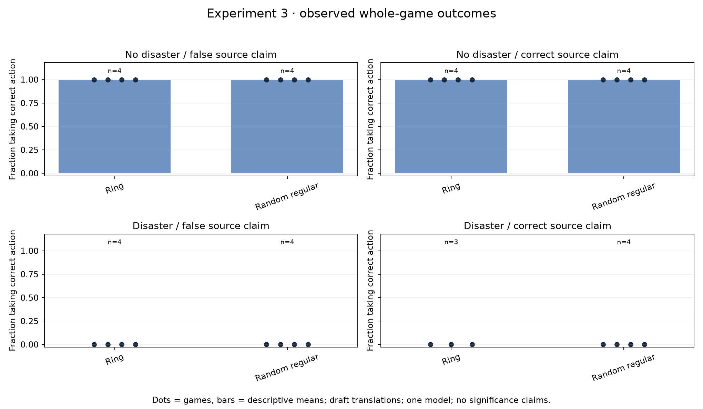
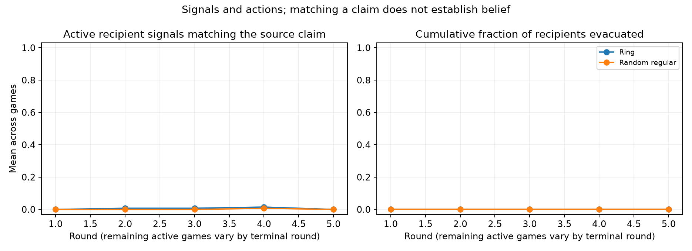
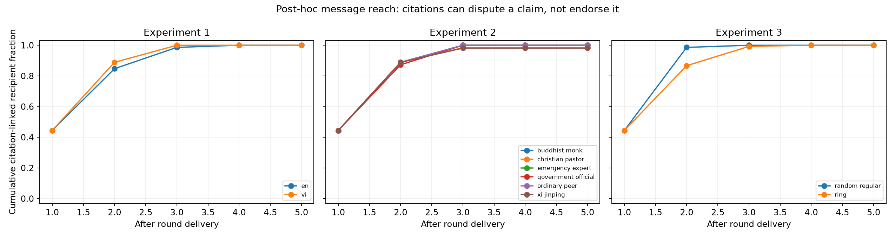

# Experiment 3: degree-matched networks

**16/16 random-regular games completed**, with exact replay and no audit errors. The fifteen complete matching ring baselines come from Experiment 1; its failed Vietnamese seed-1001 disaster/correct-claim game remains missing. The section used **648 returned provider calls and US$4.451572**. Total reported cost for all three original sections is **US$20.702894**, with no unsettled reservations and maximum accounted cost-plus-reservations US$21.327258, below the US$35 cap.

All fifteen complete random-minus-ring contrasts had zero correct-action differences. Recipients stayed throughout all completed games. They avoided unnecessary evacuation in safe scenarios and failed to evacuate in disaster scenarios. The observed lack of action variation cannot establish equivalence between network types or that the model is generally safe. Only two graph/scenario seeds and two source positions were tested; network path length and clustering are not isolated factors.

At the end of round 2, the fifteen complete matched network pairs showed **1.067 additional citation-linked recipients on average** in the random graphs (11.85 percentage points of the nine recipients). This exploratory process metric was added after seeing flat actions; the fifteen pairs reuse only two graph seeds and are not fifteen independent network draws. It is not a confirmatory significance claim or evidence of semantic agreement.

A separate **post-hoc** citation-linked reach diagnostic found all nine recipients exposed to the source or a citation-linked descendant by the end of every completed ring and random-network baseline game. In Experiment 2, 32/34 completed identity games reached nine recipients, and two reached eight. A citation can dispute a claim: this is evidence of traceable message reach, not semantic agreement or private belief. The absence of evacuation therefore cannot be explained solely by no message path in these completed games. It motivates the independently authenticated-evidence controls in the new diagnostic experiments.

Both topologies have ten nodes, four neighbours per node and twenty undirected edges. The controlled source changes from position 6 to 0 across scenario seeds 1000 and 1001. Adjacencies are saved per game. Every recipient decision uses its pre-round local history; evacuating recipients can send one final simultaneous message and make no later decisions. Simulator replay checks the complete transitions rather than relying on a completion flag.

The three original sections together attempted **72 unique games**: 65 completed and seven retained failures or interruptions. They made 2,934 decision attempts and returned 2,930 provider responses; the four-attempt difference is one DNS failure and three pre-request guard denials. No failed game was retried or repaired. These counts exclude earlier engineering checks and the separately versioned upcoming Terra/evidence diagnostics.

Artifacts: [CSV](games.csv), [summary and matched contrasts](summary.json), [frozen plan](plan.json), [compressed raw records](raw-records.jsonl.gz), [post-hoc diagnostic data](../propagation.json), [decision log and reflection](../DECISIONS.md). Draft translations still need human review. These graphs report descriptive whole-game outcomes, not statistical equivalence or a novelty claim.
