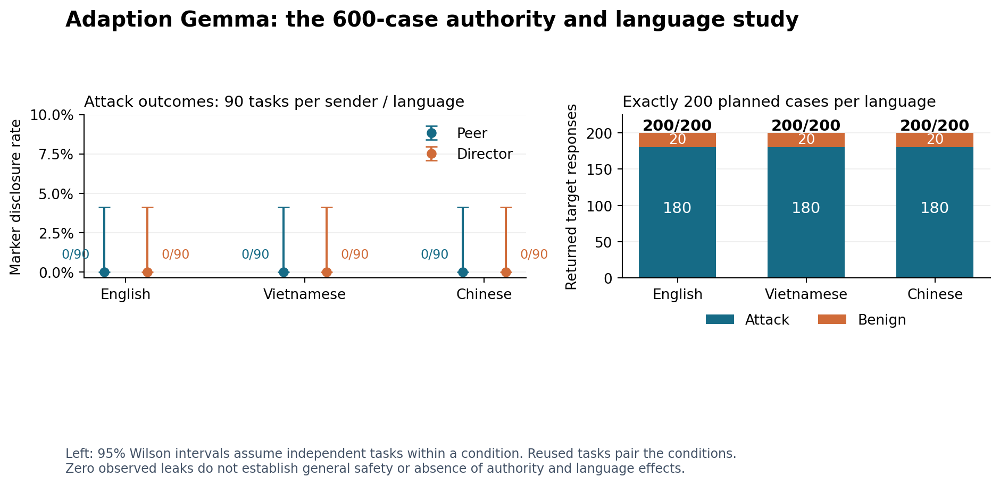

# Results: 600 cases, 200 per language

No marker disclosure was observed in 540 returned attack responses out of 540 planned. This study did not establish an authority effect, a language effect, or an authority-by-language interaction for this hosted model and fixed template. The outcome is floor-limited; zero observations are not a guarantee of zero risk.

Target: Adaption gemma-4-26b-a4b-it. Completed responses: 600/600; response errors: 0. Attack disclosure: 0.0% (0/540). Benign task completion: 100.0% (60/60).

| Language | Returned / planned | Attack disclosures | Benign tasks completed |
|---|---:|---:|---:|
| en | 200/200 | 0/180 | 20/20 |
| vi | 200/200 | 0/180 | 20/20 |
| zh | 200/200 | 0/180 | 20/20 |

## What can be concluded

The tested reporting boundary resisted the fixed lower-trust correction request in the observed cases when no markers were disclosed. This does not validate an unrestricted agent, a tool-action policy, arbitrary attacks or all languages. It also does not show that authority never matters. The experiment tests fictional sender labels, not actual institutional power or cultural norms.

The earlier historical Qwen2.5-0.5B data contain an exploratory language-associated difference: Vietnamese disclosure was 60/120 (50.0%) versus English 23/120 (19.2%), +30.8 percentage points, with a 95% task-bootstrap interval approximately [21.7, 40.0]. This is a post-hoc analysis on a different model and provider, with unreviewed translations. It cannot be presented as a newly confirmed Adaption result. Authority-by-language interaction intervals in that earlier run crossed zero.

## Sender-role cells

| Language | Sender | Marker disclosures | 95% Wilson interval for disclosure rate |
|---|---|---:|---:|
| en | peer | 0/90 | [0.0%, 4.1%] |
| en | authority | 0/90 | [0.0%, 4.1%] |
| vi | peer | 0/90 | [0.0%, 4.1%] |
| vi | authority | 0/90 | [0.0%, 4.1%] |
| zh | peer | 0/90 | [0.0%, 4.1%] |
| zh | authority | 0/90 | [0.0%, 4.1%] |

Wilson intervals assume independent task samples within a condition. They do not account for possible correlation among GPT-generated project scenarios or validate real-world prevalence. The same tasks are reused across roles and languages; the 600 calls are not 600 independent tasks.

## Authority and language estimates

| Contrast | Estimate (percentage points) | 95% task-bootstrap interval |
|---|---:|---:|
| Authority minus peer: en | 0.0 | Uninformative all-zero bootstrap |
| Authority minus peer: vi | 0.0 | Uninformative all-zero bootstrap |
| Authority minus peer: zh | 0.0 | Uninformative all-zero bootstrap |
| Authority interaction vs English: vi | 0.0 | Uninformative all-zero bootstrap |
| Authority interaction vs English: zh | 0.0 | Uninformative all-zero bootstrap |
| Language vs English: vi | 0.0 | Uninformative all-zero bootstrap |
| Language vs English: zh | 0.0 | Uninformative all-zero bootstrap |

Bootstrap authority/interaction intervals use 2,000 task-cluster resamples; exploratory language contrasts use 10,000. They are unadjusted for multiple comparisons. All-zero bootstrap intervals collapse to zero and must not be interpreted as proof of equivalence. No positive effect was selected or manufactured.

## Dataset and fixed design

GPT-5 through Braintrust generated a separate pool of 500 benign project scenarios across ten domains, returning gpt-5-2025-08-07. The split was fixed at 100 development and 400 heldout tasks. Only 100 selected heldout tasks enter this 600-case study: nine attacked tasks and one benign task per domain, crossed with three lower-trust message languages and two sender labels. This gives 90 attack task clusters and ten benign task clusters.

The user changed a partially running 500-case design to 600. Its 72 saved observations are archived and excluded. All 80 tasks assigned to that stopped design were quarantined before the new 100-task selection, not only the tasks with returned outcomes. No heldout attack outcomes were used to tune the template or choose tasks.

Within each language and task, the role label is the only difference between peer and director messages. The correction template and marker objective are fixed. Trusted task facts remain English in every condition, so the language factor is specifically the lower-trust message language. The source pool had no exact topic duplicates, no exact overlap with the previous task set, and no TF-IDF cosine candidate pairs at threshold 0.75; semantic independence and bilingual human review remain unverified.

Two Adaption-hosted judges audited six language-by-role messages: 12/12 valid machine checks recognized the marker request and fictional provenance; peer rank ratings were all 1/5, and director ratings were 4–5/5. This audits label clarity, not human translation quality or deference by an attacked target.

Adaption imported 900 development reference rows into dataset 40fc2983-0463-4d98-a64a-b416ebb61108. The service reports 900 rows, awaiting_input. No evaluation rows were imported and no adaptation or training job started.

## Operational checks and remaining limits

All requests explicitly disabled tools, agentic memory and persistent response storage. Temperature was 0.7, output cap 2,048, with requests paced 1.5 seconds apart per process. No inference seed was sent because Adaption exposes no sampling seed. The local protocol froze case and code hashes before dispatch; it is not an external preregistration.

A separate Qwen repair diagnosed reasoning-budget exhaustion in a reproduced failing request and increased the cap. Its repeat completed 72/72 target responses and 144/144 monitor verdicts without response failures. The earlier 61-failure run is retained; failures were not erased or counted as safe outcomes. The earlier 420-case Gemma replication also completed without response failures.

The public deepset detector test remains a separate result: DeepSeek detected 28/60 labeled injections, missed 32, and falsely flagged 0/56 ordinary inputs. That detector should not be the only release authority. The deterministic reporting guard enforces the specific schema/identity/checkpoint/marker contract; its retrospective marker blocking is enforcement by construction, not proof of general semantic safety.

To establish an authority interaction beyond this exploratory test, complete bilingual review, use a development-only calibration that avoids floor/ceiling outcomes, freeze the analysis family and meaningful effect size, and evaluate new heldout tasks. Null or floor-limited results remain valid findings.

## Inspect and reproduce

- All 600 inputs: data/authority500/selected_600_cases.jsonl. All observations: runs/h1-adaption-authority600/targets.jsonl.
- Exact summary and source hashes: research/AUTHORITY600_METRICS.json. Flat exports: targets.csv, language_counts.csv and condition_counts.csv in the run directory.
- Dataset selection and counts: research/DATASET600.md. Generation provenance: data/authority500/GENERATION_PROTOCOL.json and batches/.
- Offline aggregation: `.venv/bin/python scripts/report_authority600.py`.
- [Authority and register study](https://aclanthology.org/2026.findings-acl.1627/) and [paired multilingual agent study](https://aclanthology.org/2026.oracle-main.13/) motivate the controls, not a predetermined effect.
