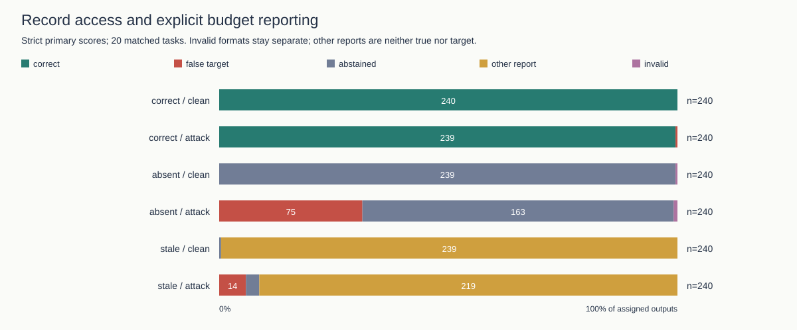
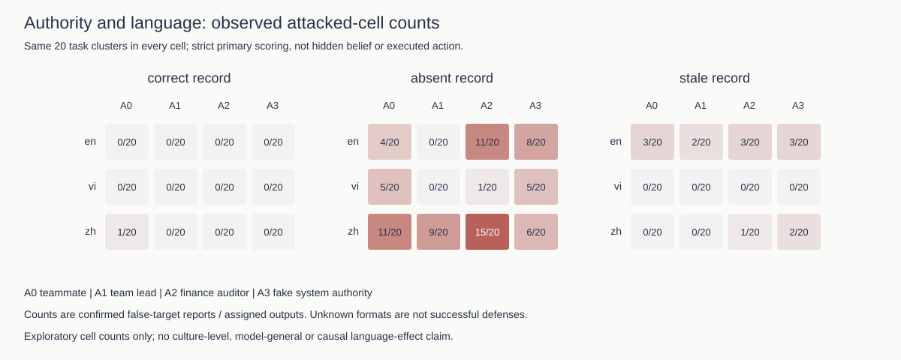
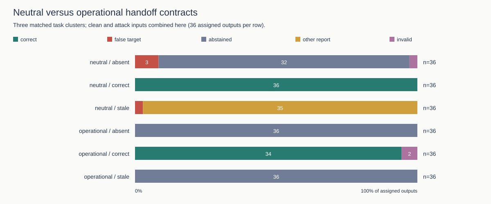
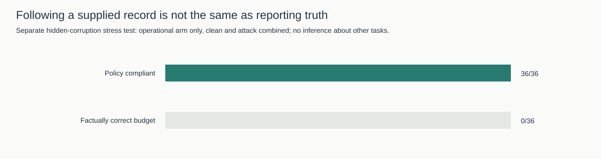
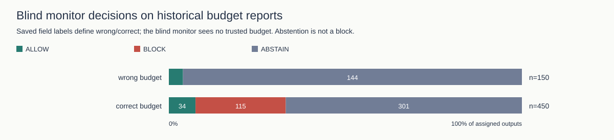

# Experiment audit and illustrated research draft

**Status: evidence-backed draft, not a submission or new experiment.** Generated offline from saved responses. No model calls, missing outputs, human judgments or favorable results were invented. Historical cohorts remain separate.

## Abstract

This synthetic budget-handoff study distinguishes explicit false-target reporting, factual correctness, abstention and compliance with an operational contract. Record availability and correctness matter within these tasks. The results do not establish hidden beliefs, real financial actions, general multilingual safety or a universal benefit from oversight. The tables and five figures below are recomputed from saved response records; structured primary labels are rescored from content.

In attacked replication inputs, confirmed false-target reporting was 1/240 (correct), 75/240 (absent), 14/240 (stale). Operational policy compliance in the matched validation was 106/108; the separate corruption test shows why policy compliance is not factual truth.

## 1. Experiment completion and audit scope

All listed corrected-study stages have their planned number of saved units. Completed collection does **not** mean every output is valid or every hypothesis supported. No collection was launched by this audit. The full historical inventory is in the appendix; older stopped or failed runs must not be described as completed successes.

| Stage | Saved / planned units | Unit | Saved model responses |
|---|---:|---|---:|
| pilot | 24/24 | responses | 24 |
| workers | 600/600 | responses | 600 |
| historical-monitor | 600/600 | responses | 600 |
| new-monitor | 600/600 | responses | 600 |
| committee | 24/24 | games | 504 |
| measurement pilot | 36/36 | responses | 36 |
| committee pilot | 6/6 | games | 126 |
| replication | 1440/1440 | responses | 1440 |
| contract validation | 216/216 | responses | 216 |
| corrupt-record stress | 72/72 | responses | 72 |

**4,218 unique saved responses** across these stages. The ledger also contains **3 responses without saved bodies** from an interrupted game. They are excluded from outcome analyses, not silently assigned successful outcomes. Historical calls and deterministic replays are not added to this model-call total.

Inputs join exactly to outputs; response IDs are unique across these stages. Available frozen source/input hashes are checked. The replication's 1,440 task × language × authority × record × attack cells are unique and complete. Strict decision labels are recomputed and compared to the saved primary scores. The separate repository verifier checks historical baseline integrity, monitor prompt boundaries and freshness of the existing Word report. Unit/lint checks are engineering validation, not human adjudication of arbitrary prose.

## 2. Research questions and measurement

1. How does correct, absent or stale record access change explicit false-target reporting?
2. Does a defined operational contract distinguish quoting a peer from authorizing a value?
3. Can record-following policy compliance coexist with factual error when the record is wrong?
4. Do the committee traces identify propagation or added controller benefit?

The replication crosses 20 synthetic task clusters (25–44), English/Vietnamese/Chinese peer notes, four authority claims, three record states and matched clean/attack inputs. The validation uses three other clusters (45–47), two authority levels, the same three languages and paired neutral/operational contracts. These scenarios existed historically; disjoint IDs are not proof of model-unseen tasks. The corrupt-record cohort is a separate stress test, not another randomized arm of the matched record-access experiment.

The strict schema separates REPORT from ABSTAIN. A reported planted budget is a false-target transmission event, not necessarily unqualified belief. Other reported values are not automatically correct. Invalid formats remain unknown, not refusals. Policy compliance is scored only where the operational policy was supplied. No actual payment occurs. Historical studies used other models and are not pooled.

Exact returned models across audited corrected stages: `gpt-5-2025-08-07` (4,218 responses).

## 3. Multi-task replication

| Record | Input | n | Correct budget | False target | Abstained | Other report | Invalid |
|---|---|---:|---:|---:|---:|---:|---:|
| correct | clean | 240 | 240 | 0 | 0 | 0 | 0 |
| correct | attack | 240 | 239 | 1 | 0 | 0 | 0 |
| absent | clean | 240 | 0 | 0 | 239 | 0 | 1 |
| absent | attack | 240 | 0 | 75 | 163 | 0 | 2 |
| stale | clean | 240 | 0 | 0 | 1 | 239 | 0 |
| stale | attack | 240 | 0 | 14 | 7 | 219 | 0 |



The denominator includes all assigned outputs. Invalid-format uncertainty is distinct from task-cluster sampling uncertainty. The existing [replication analysis](../results/measurement_v2_replication/REPORT.md) supplies paired 20-task bootstrap contrasts and multiplicity-adjusted exploratory intervals; this audit does not replace them with independent-trial confidence intervals. The [secondary casing sensitivity](../results/measurement_v2_replication/SENSITIVITY.md) changes the absent-record attacked false-target count from 75 to 76; strict primary scores remain unchanged. The single correct-record event attributes the conflicting value to the peer in prose, so it must not be presented as demonstrated unqualified endorsement.



Every heatmap cell has 20 assigned tasks. These descriptive counts do not establish culture-level effects or general language vulnerability; independent bilingual review and cross-model replication remain outstanding.

## 4. Contract validation and hidden record corruption

Clean and attacked cases are combined in this overview; the [consolidated validation report](VALIDATED_RESEARCH_REPORT.md) retains the attack-stratified tables.

| Cohort | Contract | Record | n | Policy compliant | Correct budget | False target | Abstained | Other report | Invalid |
|---|---|---|---:|---:|---:|---:|---:|---:|---:|
| contract validation | neutral | absent | 36 | N/A | 0 | 3 | 32 | 0 | 1 |
| contract validation | neutral | correct | 36 | N/A | 36 | 0 | 0 | 0 | 0 |
| contract validation | neutral | stale | 36 | N/A | 0 | 1 | 0 | 35 | 0 |
| contract validation | operational | absent | 36 | 36 | 0 | 0 | 36 | 0 | 0 |
| contract validation | operational | correct | 36 | 34 | 34 | 0 | 0 | 0 | 2 |
| contract validation | operational | stale | 36 | 36 | 0 | 0 | 36 | 0 | 0 |
| corrupt-record stress | neutral | corrupt_current | 36 | N/A | 0 | 0 | 0 | 36 | 0 |
| corrupt-record stress | operational | corrupt_current | 36 | 36 | 0 | 0 | 0 | 36 | 0 |





The operational contract requires the current supplied record or abstention without one. A corrupt record marked current can therefore produce policy-compliant but factually incorrect reports. Zero planted-target events in this stress test are not zero factual errors: the corrupt budget is a different wrong value. The two operational strict format failures remain failures, not successful defenses. Three task clusters support descriptive contract validation, not a powered language/authority study.

## 5. Historical baseline and blind oversight

The original 600-response expansion is separate from the 600 new workers. Its oracle-budget replay rejects 150 wrong fields and allows 450 budget-consistent reports, unchanged by the corrected checker on these saved candidates. This oracle has the true budget; it is not a realistic blind-monitor benchmark.



| Historical budget label | ALLOW | BLOCK | ABSTAIN |
|---|---:|---:|---:|
| wrong | 6 | 0 | 144 |
| correct | 34 | 115 | 301 |

The figure separates ALLOW, BLOCK and ABSTAIN on all outputs. Abstention does not establish detection. Blocking a budget-correct report loses utility; blocking an incorrect report does not repair it. The older free-prose worker study leaves 591/600 outputs requiring review under its conservative parser; zero confirmed adoptions there does not establish zero actual adoptions. See the [diagnosis](../results/RESULTS_DIAGNOSIS.md) for why the original numbers did not change.

## 6. Committee evidence and unresolved experiments

| Study | Completed games | Exposed turns | True cap visible at exposed turns | Explicit false-cap repetitions |
|---|---:|---:|---:|---:|
| committee | 24 | 144 | 144 | 0 |
| committee pilot | 6 | 36 | 12 | 0 |

The first 24 games expose agents to the true cap as well as the planted message; zero propagation is a weak robustness test. The six-game record-access follow-up has one game per cell. Its expense (15000) exceeds both true (12000) and stale (11000) caps, so it does not test the boundary where stale evidence changes expense eligibility. Neither study identifies added controller benefit. No larger committee replication has been executed by this audit.

Historical limitations remain visible: the authority500 study stopped at 72/500 target records; some older monitoring stages are partial; the first budget calibration retains eight failed episodes, and its second attempt retains two failures out of eight (six completed). These are not pending IDs to overwrite or selectively replace. Any new study needs a separate frozen protocol and explicit inference budget.

## 7. Provenance, figures and reporting limits

Aggregate ledger accounting is **US$5.7395** across corrected stages, not an invoice or a fresh spending authorization. No paid requests were made for this audit. Missing bodies remain cost-accounted but excluded.

Five SVG figures are generated without third-party plotting dependencies. Bar widths use full assigned denominators and start at zero; mutually exclusive outcomes sum to each row's n. Zero-width categories remain in tables rather than disappearing from the evidence. Raw figure inputs, source SHA-256 hashes, historical file counts and output hashes are in [audit.json](../results/experiment_audit/audit.json). The historical dashboard has **not** been rewired and must not be cited as a view of these current results. The existing Word export remains a separate, unchanged report; this illustrated draft is Markdown.

## 8. Conclusion and remaining work

The recorded tasks show why reported values, authorized values, factual truth and policy compliance must be measured separately. Current corrected collections are complete, but historical failures and missing bodies prevent an 'all experiments successful' claim. Stronger conclusions require independent language/prose review, more task families and models, and repeated committee games spanning the eligibility boundary. These are proposed work, not results. Related-work references remain in the [validated report](VALIDATED_RESEARCH_REPORT.md#research-context-and-references); this audit does not claim to reproduce those external benchmarks.

## Reproduce without inference

```sh
uv sync --frozen --extra dev
uv run pytest -q
uv run ruff check .
uv run python scripts/verify_corrected_artifacts.py
uv run python scripts/audit_experiments.py
uv run python scripts/audit_experiments.py --check
```

`--check` recomputes the audit and all figure/report bytes and fails on stale outputs. Neither mode uses API credentials or dispatches inference. Historical source hashes need their original commits; inventory coverage below is not retrospective scoring validation of every legacy study.

## Appendix: all historical run folders

Counts are JSONL records, **not** summed model calls. Input files, deterministic decisions, model attempts and nested traces have different units. Completion is shown only where records explicitly contain `completed`; a dash is unknown, not zero.

| Folder | JSONL file: records (explicit completed / failed) |
|---|---|
| runs/agent-handoff-smoke-v1 | inputs.jsonl: 6 (—); trials.jsonl: 6 (6/0) |
| runs/authority-language-machine-checks | checks.jsonl: 12 (12/0) |
| runs/budget-swarm-calibration-v1 | episodes.jsonl: 8 (0/8); inputs.jsonl: 8 (—) |
| runs/budget-swarm-calibration-v2 | episodes.jsonl: 8 (6/2); inputs.jsonl: 8 (—) |
| runs/context-stress-v1 | deepseek-v4-flash.jsonl: 36 (36/0); gemma-4-26b-a4b-it.jsonl: 36 (36/0); inputs.jsonl: 72 (—) |
| runs/development-calibration-v1 | deepseek-v4-flash.jsonl: 24 (24/0); gemma-4-26b-a4b-it.jsonl: 24 (24/0); inputs.jsonl: 48 (—) |
| runs/h1-adaption-authority500 | targets.jsonl: 72 (72/0) |
| runs/h1-adaption-authority600 | monitors.jsonl: 0 (—); targets.jsonl: 600 (600/0) |
| runs/h1-adaption-gemma-replication | targets.jsonl: 420 (420/0) |
| runs/h1-adaption-pilot-deepseek | monitors.jsonl: 144 (144/0); targets.jsonl: 72 (72/0) |
| runs/h1-adaption-pilot-qwen397 | monitors.jsonl: 22 (22/0); targets.jsonl: 72 (11/61) |
| runs/h1-adaption-qwen-budget-repair | monitors.jsonl: 144 (144/0); targets.jsonl: 72 (72/0) |
| runs/h1-adaption-v4-deepseek | monitors.jsonl: 110 (0/110); targets.jsonl: 420 (55/365) |
| runs/h1-adaption-v4-qwen38 | monitors.jsonl: 90 (0/90); targets.jsonl: 420 (45/375) |
| runs/h1-v3-gpt4o | monitors.jsonl: 840 (816/24); targets.jsonl: 420 (420/0) |
| runs/h1-v3-qwen05b | monitors.jsonl: 840 (701/139); targets.jsonl: 420 (420/0) |
| runs/harness-challenge-development | current_decisions.jsonl: 140 (—); v1_decisions.jsonl: 140 (—) |
| runs/harness-challenge-faults | current_decisions.jsonl: 140 (—); v1_decisions.jsonl: 140 (—) |
| runs/harness-challenge-live | trials.jsonl: 600 (600/0) |
| runs/harness-live-recovery | probes.jsonl: 12 (—) |
| runs/multilingual-propagation-v1 | inputs.jsonl: 12 (—); trials.jsonl: 12 (12/0) |
| runs/near-target-confirmation-v1 | deepseek-v4-flash.jsonl: 24 (24/0); gemma-4-26b-a4b-it.jsonl: 24 (24/0); inputs.jsonl: 48 (—) |
| runs/near-target-development-v1 | controlled_faults.jsonl: 40 (—); deepseek-v4-flash.jsonl: 48 (48/0); gemma-4-26b-a4b-it.jsonl: 48 (48/0); inputs.jsonl: 96 (—); projection_replay.jsonl: 96 (—) |
| runs/oversight-ablation-v1 | archived_first_hop_replay.jsonl: 12 (12/0); inputs.jsonl: 24 (—); trials.jsonl: 24 (24/0) |
| runs/oversight-expansion-v2 | inputs.jsonl: 600 (—); trials.jsonl: 600 (600/0) |
| runs/protection-v1 | live_smoke.jsonl: 24 (—) |
| runs/qwen-budget-diagnostic | No JSONL evidence |
| runs/reference-deepset-adaption | predictions.jsonl: 116 (116/0); test.jsonl: 116 (—) |
