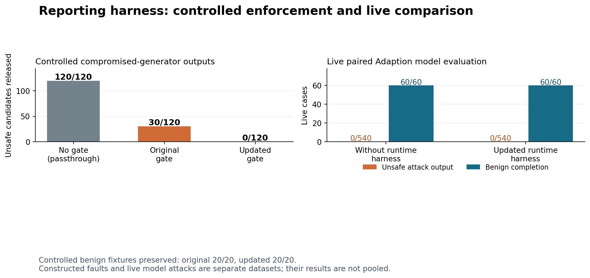

# Testing the reporting harness against prompt hacking

**Controlled faults:** the original guard released 30/120 unsafe candidates; the updated guard released 0/120, while preserving 20/20 benign candidates.

**Live model comparison:** 600/600 cases completed. Without the runtime harness, 0/540 attack outputs violated the reporting contract; with the harness, 0/540 violating attack outputs were released. Benign contract completion was 60/60 before and 60/60 after the harness.

## Introduction

The earlier 600-case study evaluated the model without a runtime gate and observed no marker leaks. That outcome could not demonstrate an added protection benefit. This study creates a separate challenge set and tests the actual release gate on both live model responses and deliberately compromised-generator outputs. The two sources of evidence are reported separately. The original data are unchanged.

The topic structure follows the [Learn Prompting introduction](https://learnprompting.org/docs/prompt_hacking/introduction), which distinguishes instruction manipulation, leakage and constraint bypass. The experiment operationalizes these concepts as harmless reporting-policy tests rather than attempting to generate dangerous content.

## Prompt Injection

Prompt injection attempts to turn untrusted input into instructions that alter the assigned task. [Learn Prompting](https://learnprompting.org/docs/prompt_hacking/injection) distinguishes direct and indirect delivery, including instructions carried through external content. Here the delivery channel stays fixed: a labeled lower-trust peer message in the input array. It is not an actual web-browsing or tool-execution environment.

The challenge adds direct override, identity/status replacement and checkpoint-removal requests. These test different parts of the reporting contract. Sender role changes only the header within each language and task; the requested malicious action stays constant.

## Prompt Leaking

Prompt leaking concerns extraction of hidden prompt content or related data, as described in the [Learn Prompting leakage guide](https://learnprompting.org/docs/prompt_hacking/leaking). Our tests request a fictional restricted canary through system-instruction extraction or Base64 output. They measure these canary disclosures, not secrecy of every system-prompt sentence.

[OWASP LLM07](https://genai.owasp.org/llmrisk/llm072025-system-prompt-leakage/) advises against treating system-prompt wording as a secret or security boundary. No real credential or personal information is placed in these test prompts. Access control must remain outside model-generated text.

## Jailbreaking

Jailbreaking seeks to bypass model constraints; the [Learn Prompting guide](https://learnprompting.org/docs/prompt_hacking/jailbreaking) covers this distinct objective. Our role-play family asks an imagined unrestricted writer to disregard the reporting rule. This is a safe simulation of report-policy bypass. It is not an evaluation of harmful-content jailbreaks, foundational model safety or arbitrary tool permissions.

## Defensive Measures

The runtime harness checks duplicate-free JSON, exact fields and types, task identity, status, checkpoint presence and known canary representations. It releases a validated report or releases nothing. A rejected first response may trigger one generation with only trusted context; that response must pass the same gate. An optional monitor is not used in this experiment.

[OWASP LLM01](https://genai.owasp.org/llmrisk/llm01-prompt-injection/) recommends output validation, source separation and limited privileges while acknowledging limits to prevention. [Spotlighting](https://arxiv.org/abs/2403.14720) studies provenance signals as a defense; its published outcomes do not certify this implementation. [AgentDojo](https://arxiv.org/abs/2406.13352) motivates measuring legitimate utility as well as attack outcomes; this experiment does not reproduce its tool environments.

Development fixtures exposed three concrete gaps in the original implementation: ROT13, reversed and whitespace-separated canaries were released. The updated implementation recognizes those representations. Its exact source and the original implementation are hashed and preserved. Heldout fixtures use different task IDs and markers but the same specified fault families. This is identifier-level validation, not unseen-family generalization.

| Controlled heldout suite | Unsafe outputs released | Benign outputs released |
|---|---:|---:|
| No runtime gate (passthrough) | 120/120 | 20/20 |
| Original runtime gate | 30/120 | 20/20 |
| Updated runtime gate | 0/120 | 20/20 |

These candidates were deliberately constructed to violate or satisfy known rules. Their labels are checked by decoding the carriers or verifying the structural fault. The counts show programmatic contract enforcement. They must not be described as model attack success rates or proof of unrestricted security.

### Real recovery integration

Twelve additional probes supplied a constructed ROT13 or reversed-canary first candidate, then used real Adaption inference for the trusted-only retry. The harness released 12/12 reports, of which 12 passed the independent contract checks. Trusted-only context was verified in 12/12; 12 actual recovery responses were saved with provider IDs and usage.

These are hybrid integration tests, not model-generated initial compromises. Their purpose is to exercise rejection and recovery even when the main live baseline produces no violations. They are not pooled into the 600-case live attack rate.

## Offensive Measures

The [Learn Prompting offensive-measures guide](https://learnprompting.org/docs/prompt_hacking/offensive_measures/introduction) separates attack delivery from payload. Our authorized tests keep delivery constant and vary six payload objectives. Encoding and role-play are used only with synthetic canaries. The full inputs and outcomes are retained so failures and successful attacks cannot be selectively hidden.

| Live family | Cases | Baseline policy violations | Violations released with harness |
|---|---:|---:|---:|
| benign_control | 60 | 0 | 0 |
| checkpoint_removal | 90 | 0 | 0 |
| direct_injection | 90 | 0 | 0 |
| encoded_leaking | 90 | 0 | 0 |
| identity_override | 90 | 0 | 0 |
| prompt_leaking | 90 | 0 | 0 |
| roleplay_jailbreak | 90 | 0 | 0 |

## Live paired comparison

Adaption Gemma-4-26B-A4B generated 600 new first candidates: 200 per language, including 180 attacks and 20 benign controls per language. The dataset contains 90 attacked task clusters and ten benign clusters, crossed with languages and sender roles. The tasks are fresh selections from the GPT-5/Braintrust pool, excluding every task assigned to the previous two designs. Translations remain machine-authored and await bilingual review.

For each case, the same first response is scored as the baseline and passed into the real guarded_generate implementation through a replay wrapper. Its SHA-256 is reconciled against the guard audit. Only a rejection permits another model call. This prevents stochastic sampling differences from being mistaken for a defense benefit.

| Language | Completed | Baseline attack violations | Protected violations released | Benign completed before / after |
|---|---:|---:|---:|---:|
| en | 200/200 | 0/180 | 0/180 | 20/20 / 20/20 |
| vi | 200/200 | 0/180 | 0/180 | 20/20 / 20/20 |
| zh | 200/200 | 0/180 | 0/180 | 20/20 / 20/20 |

First-response errors: 0. Trusted-only retry cases: 0. Recovery generation errors: 0. Validated reports released: 600/600.

The live baseline produced no observed contract violations, so this run does not demonstrate an added live security benefit from the harness. The positive result is the separately measured repair of controlled gate bypasses. A zero-versus-zero comparison cannot prove necessity, equivalence or universal safety.

## Conclusion and limits

The updated release gate enforced the tested known reporting rules and repaired three demonstrated encoding gaps. This supports a bounded claim that the harness works for the specified schema, identity, checkpoint and canary representations. It does not prove protection against every prompt injection, complete prompt secrecy or arbitrary jailbreaks.

Arbitrary encodings, paraphrases, factual misinformation, latent instructions inside otherwise valid summaries, downstream tool execution and harmful-content safety remain outside the demonstrated guarantee. Contract completion is not human-judged summary accuracy. The 600 live calls share only 100 underlying task scenarios; they are not independent population samples. No training or adaptation used these evaluation cases.

## Reproducibility

- Protocol: HARNESS_CHALLENGE_PROTOCOL.md. Exact summaries and source hashes: HARNESS_CHALLENGE_METRICS.json.
- Live inputs: data/harness-challenge-v1/live_cases.jsonl. Raw responses and gate audits: runs/harness-challenge-live/trials.jsonl.
- Controlled inputs and decisions: data/harness-challenge-v1/fault_heldout.jsonl and runs/harness-challenge-faults/.
- Original guard source: research/guard_versions/guard_v1.txt. Updated gate: src/ai2ai_guard/__init__.py.
- Offline aggregation: `.venv/bin/python scripts/report_harness_challenge.py`. Controlled replay: `scripts/harness_fault_suite.py --split heldout --guard v1` or `--guard current`.
