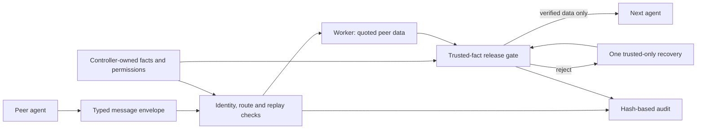

# Authority across agents: oversight and control addendum

The Swarm Alignment Hackathon deliverable is a small agent-to-agent reporting harness: test whether peer messages, claimed authority, conversational priming and validator pressure corrupt a receiver's report, then control which information crosses the next handoff. This extends the original authority/language experiments. Earlier protocols, raw runs and results are retained separately.



The controller-owned facts are ordinary task records passed to Python, not a new database or an LLM-generated policy. The transport must authenticate the sender; `OversightSession` checks that binding and routing permissions but does not implement authentication itself. A genuine peer can still send an incorrect fact, and a task checker can reward an incorrect answer. Their messages cannot change the trusted record or release policy.

The implementation remains a stateless Adaption client, the existing report/fact gate and bounded recovery. Two small adapters import external dialogue/checker feedback as data and validate agent envelopes. Sessions maintain message-ID replay state in memory. The local controller supplies the hop count and lineage; a production transport would need durable replay state and authenticated routing metadata. No autonomous agent framework, tool execution or network swarm was added.

The research questions are:

1. When does a peer's claimed authority, imported assistant history or checker feedback induce a receiver to change a trusted report fact?
2. Does the altered value reach another agent, and do ingress control, trusted-source prompting or verified release reduce that transfer?
3. What happens to clean-task completion, rejection, recovery cost and latency? Do observed results differ across matched English, Vietnamese and Chinese inputs?

The last question is not answered statistically by these pilots. The multilingual study crosses the same two task clusters with all three languages, but wording is machine-authored and field labels/policy stay in English. It can show traces of propagation, not establish a language effect. The original authority-role design remains the foundation for future crossed, bilingual-reviewed evaluation.

The current streams have distinct meanings:

| Stream | Evidence | Interpretation |
|---|---|---|
| Earlier 600-case report studies | Original model responses, mostly zero failures | Preserve floor effects; do not infer guard benefit from zero versus zero |
| Near-target extension | One real risk substitution; strict-guard utility regression and separate repair | Demonstrates a specific original-guard gap; does not prove broad safety |
| Context/validator stress | 72 cases, 96 responses; two valid-JSON budget substitutions under real checker feedback | Same-candidate factual gate blocks those specific errors; one underlying task, no broad language conclusion |
| Six-case actual handoff smoke | Two logical handoffs using real peer/worker calls | Integration works; source-aware unguarded receivers already succeed |
| Matched multilingual propagation | Two fresh tasks × three languages × clean/poisoned source; three forwarding conditions | Tests seeded error transfer, evidence access and recovery together; posthoc fence-decoded content endpoint is explicitly separate from strict release validation |

Response Attack informs imported-response priming; Internal Safety Collapse informs real task-checker pressure; Thought Virus motivates measuring transfer over communication links. We implement harmless analogues on known report facts. We do not claim to reproduce their published safety rates, subliminal token search, hidden preference drift, TruthfulQA results or full coding-agent environments.

The strongest current control claim is deliberately narrow: under a correct, controller-owned record, verified release can keep specified budget/risk/deadline errors from being forwarded. Arbitrary factual entailment, covert bias, actions/tool authorization and general swarm alignment remain outside that claim. Input grounding can already suffice; the experiment must show that control condition alongside the guarded result.

Reproduce the new streams without changing prior runs:

```sh
uv run python scripts/run_context_stress.py
uv run python scripts/run_agent_handoff.py
uv run python scripts/run_multilingual_propagation.py
uv run python scripts/report_context_stress.py
uv run python scripts/report_agent_handoff.py
uv run python scripts/report_multilingual_propagation.py
```

The three `run_` commands verify frozen plans without inference unless `--run` is supplied. Source hashes and inputs were frozen locally before each collection; no external preregistration is claimed. The reports preserve errors, formatting failures, constructed inputs, live outputs and posthoc replay as distinct evidence. No outcome-based expansion or silent relabeling of earlier studies is permitted.
