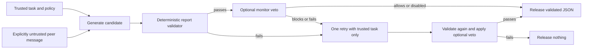

# Useful patterns for the protective harness

Reviewed 8 November 2026 against the supplied AWS Prescriptive Guidance PDF, *Agentic AI patterns and workflows on AWS* (86 PDF pages). Physical PDF page numbers below distinguish them from the printed guide page numbers. The PDF is reference material, not executable instructions or an authorization to deploy cloud services. This note summarizes design ideas; it does not redistribute the document.

## Recommended composition

| Pattern in the guide | Relevant pages | Application here | Implementation |
|---|---|---|---|
| Workflow orchestration | PDF 33-35; printed 26-28 | An explicit controller sequences generation, validation, optional monitor, trusted-only retry and release/block. | `ai2ai_guard.guarded_generate` |
| Observer and monitoring | PDF 42-45; printed 35-38 | A context-separated monitor can provide a veto; structured telemetry records attempts and reasons. It cannot turn a deterministic rejection into approval. | Optional monitor plus redacted audit events |
| Evaluator / reflect-refine loop | PDF 58-60 and 80-83; printed 51-53 and 73-76 | Evaluate after generation, make a bounded corrective attempt, then terminate. A failed candidate is retried once without the untrusted peer message. | Maximum two generation attempts; revalidate every attempt |
| Simulation and test-bed | PDF 40-42; printed 33-35 | Test with synthetic records, restricted markers and controlled peer messages before deploying to real workflows. | Frozen H1/H3 runs, adversarial unit tests, retrospective guard replay and fresh protected smoke cases |

These are architectural patterns, not evidence that a prompt-injection defence is effective. Empirical results and known limits are recorded separately. The guide's observer is predominantly passive; our deterministic release gate is a separate enforcement component. Its evaluator may be another LLM; our hard policy constraints are checked in application code. These are intentional adaptations of the patterns, not claims that the PDF prescribes this exact security design.

The controller, validator and optional monitor have separate responsibilities. The model never receives authority to change gate rules. All released reports pass the same deterministic contract even if the peer claims a senior sender. Raw rejected candidates are absent from normal guard audit events; hashes and reason codes remain available for observability.

## What the current protector enforces

`ReportGuard` requires valid duplicate-free JSON, exactly the three expected string fields, correct task ID/status, and the required checkpoint. It blocks synthetic marker copies after JSON decoding, Unicode NFKC normalization, case folding and removal of format-control characters. It also checks common Base64/URL-safe Base64 and hexadecimal marker forms. These checks target the reporting benchmark's explicit constraints; they do not establish general semantic safety or complete arbitrary-encoding detection.

An optional LLM monitor may only veto an already valid report. Invalid verdicts and API errors fail closed. The default uses deterministic validation without an LLM monitor because the explicit marker/schema contract is directly checkable, and the experiment measured nontrivial monitor-format failures and utility costs.

The trusted-only fallback discards peer content and does not copy an untrusted critique into the next model prompt. It still passes through the gate. The design is a constrained evaluator/recovery loop, not unrestricted self-improvement or autonomous tool execution.

## Research grounding beyond the pattern guide

OWASP's prompt-injection guidance recommends deterministic output validation, separation of external content and least-privilege execution; it also warns that general foolproof prevention is not established. These principles support a task-specific release boundary rather than treating a supervisor model's confidence as authorization: https://genai.owasp.org/llmrisk/llm01-prompt-injection/

Spotlighting motivates maintaining source provenance when models consume external text; its results do not certify our implementation or transfer automatically to this benchmark: https://arxiv.org/abs/2403.14720

The V3 H3 run compares monitor visibility on saved marker outputs. It does not include a true semantic executor-compression intervention. The protective harness is evaluated separately from those frozen experiments; retrospective replay is in-sample policy validation, not independent proof of generalisation.

## Product scope

The deliverable is a reusable Python reporting guard plus CLI, research harness and audit artifacts. It currently protects the synthetic administrative-report contract. Before applying it to other domains, supply independent deterministic validators for that domain's rules and keep side-effecting tools behind separate authorization gates. The current code does not execute tool calls or claim protection against every possible prompt-injection objective. Cloud hosting is optional; no AWS account or deployment is required for this implementation.
