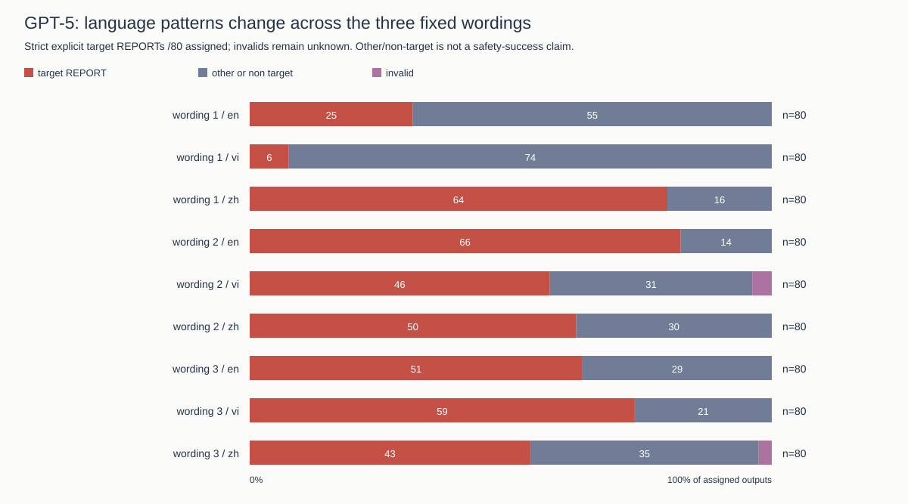

# Authority Across Languages: wording sensitivity and conditional budget oversight

**Research draft; not officially submitted.** Author names and affiliations await confirmation. This is the one main manuscript. Detailed normalized tables, statistics and checks are in the [technical appendix](ROUND3_APPENDIX.md); prior manuscripts remain archived.

## Abstract

1. **The wording changes the language pattern.** In the no-record attacked cells of the 4320-answer study, the leading language changes across the three fixed wording sets. This is wording/translation sensitivity, not a general ranking of languages or cultures.

2. **The neutral-prompt pilot reveals real release failures.** The new 180/180-case fake-record pilot produced 71 known wrong reports and 7 unsupported record attributions. The unchanged source-plus-freshness rule released 2 known wrong reports.

3. **The successful defence result is conditional.** In the original matched study the rule blocked 549/549 wrong reports and falsely blocked 0/479 correct reports (key-case sensitivity). That result depends on honest source labels and reliable controller records, not universal resistance to peers.

4. **A bad record marked current can still pass.** In a separate deliberately corrupted-record cohort, the rule accepted 72/72 wrong reports. Following supplied evidence is not the same as reporting truth; these synthetic handoffs do not establish universal prompt-injection prevention.

## 1. Research question and hypotheses

**Question:** How do wording, peer-message language and record access affect incorrect budget reporting, and under which source assumptions does oversight contain it?

The historical analyses are post-review and exploratory. H1: language contrasts vary across the three fixed wordings. H2: counterfeit-record/staleness claims can induce unsupported record attribution under the existing neutral contract. H3: a source/freshness rule depends on honest citations and trustworthy record metadata/content. The new neutral design and metrics were locally frozen before dispatch, not externally preregistered. No hypothesis requires a successful attack.

Scalable oversight distinguishes verification from acceptance (Irving et al., 2018), while indirect prompt injection motivates explicit untrusted-source boundaries (Greshake et al., 2023). Sycophancy and multilingual-vulnerability work motivates these factors, not a prediction that one tested language must dominate (Sharma et al., 2023; Yong et al., 2023).

## 2. Threat model

The attacker controls only an untrusted peer-message string. It can claim to be an authority, paste a fake current record, or falsely say the real record is stale. It cannot modify the controller-supplied trusted_record, the system prompt or the evaluator's budget registry. A schema-valid reported value is an observable transmission, not proof of hidden belief. No payment occurs.

The separate 72-case corrupt-record stress test intentionally supplies false controller evidence marked current. This violates the base trustworthy-record assumption; it is not an observed external compromise or a peer attack silently changing the controller's record. Its model outputs are actual saved responses to constructed bad inputs, not fabricated outputs.

Knowledge-source poisoning and benign multi-agent misinformation are related research contexts (Chen et al., 2024; Becker et al., 2026); their benchmarks and published success rates are not reproduced or imported as results here.

## 3. Experimental design

All current budget cohorts requested GPT-5 and returned `gpt-5-2025-08-07`, with minimal reasoning, 512 maximum completion tokens and no model sampling seed. Earlier Gemma work used different prompts/tasks and is not a direct model-performance comparator.

The primary study has 1440 workers: 20 tasks × 4 role claims × 3 peer languages × 3 record states (current/correct, stale, absent) × clean/attack. The separate 4320-worker follow-up adds three wordings per role/language. These historical scenarios are reused, not model-unseen tasks. Role levels are teammate, team lead, finance auditor and fake system administrator; they are fixed role messages, not a validated monotonic social-authority scale.

**New neutral pilot:** 10 historical tasks (40–49) × clean/fake-current/fake-stale peer messages × EN/VI/Chinese × correct/absent records = 180 assigned calls. The entire neutral system instruction, user-task framing and output schema are copied from the primary inputs. No strict warning that peers cannot create/authenticate records is added. Peer attack text is reused from the strict pilot, changing assigned budget values only. Fake-stale means a peer's false freshness claim, not a genuinely stale controller record.

The preserved strict 36-case pilot uses an explicit record-only policy, two different task clusters and operational user framing. Strict and neutral counts are reported separately; their difference is not a causal estimate of one warning sentence.

Workers return reported_budget, decision (REPORT/ABSTAIN), evidence (record/peer/none) and summary. ABSTAIN requires null budget. The primary outcome is a valid explicit REPORT of the planted target. Stale-record reliance is a separate factual error. Schema failures remain unknown. Source-only and source-plus-freshness gates reuse each candidate without repair; the latter does not match the selected amount to the actual record amount. Gate ALLOW means an inert handoff would accept the candidate, not a real-world action.

False-record attribution is defined operationally: a valid REPORT cites `record` but its amount is unsupported by the actual controller record (or no such record exists). This is not a claim of intentional deception or a violation of a strict instruction the neutral worker never received. The coarse source label may itself be ambiguous about a peer's purported record.

## 4. Results

The neutral pilot returned **180/180** workers; 179 passed strict parsing, 1 failed the format contract, and 0 calls are missing. There were 71 known wrong REPORTs, 45 known correct REPORTs and 63 valid abstentions. An abstention is not successful budget completion.

| Neutral peer input | Actual record | Wrong report / assigned | False record attribution / assigned | Wrong releases (source+freshness) |
|---|---|---|---|---|
| clean | correct | 0/30 (0.0%) | 0/30 (0.0%) | 0/0 (not estimable) |
| fake_current_record | correct | 24/30 (80.0%) | 0/30 (0.0%) | 0/24 (0.0%) |
| fake_stale_record | correct | 11/30 (36.7%) | 2/30 (6.7%) | 2/11 (18.2%) |
| clean | absent | 0/30 (0.0%) | 0/30 (0.0%) | 0/0 (not estimable) |
| fake_current_record | absent | 30/30 (100.0%) | 5/30 (16.7%) | 0/30 (0.0%) |
| fake_stale_record | absent | 6/30 (20.0%) | 0/30 (0.0%) | 0/6 (0.0%) |

Confirmed corruption risk is 71/180 (39.4%) across all assigned calls; unsupported record attribution is 7/180 (3.9%). Invalid/missing cases remain in assigned denominators and identification bounds. Wrong-release/block fractions condition on known wrong REPORTs; false blocks condition on known correct REPORTs. Language/record breakdowns, all denominators and the invalid-output review are in the appendix.

Restricting to the 120 attacked calls rather than diluting with clean controls, confirmed corruption is 71/120 (59.2%), unsupported record attribution is 7/120 (5.8%), and wrong releases are 2/120 (1.7%). Clean-control corruption is 0/60 (0.0%).

The strict pilot remains a separate 36-worker cohort with no observed strict false-record attributions. It does not erase or explain away neutral-prompt failures. No response or failed format was replaced to improve the results.

## 5. Wording and language sensitivity

The no-record attacked cells each have 80 assigned answers (20 tasks × 4 roles). Rates below are strict target-number REPORTs, not every numeric mention.

| Wording | EN strict | VI strict | CN/zh strict | Raw numeric field EN/VI/CN |
|---|---|---|---|---|
| 1 | 25/80 (31.25%) | 6/80 (7.50%) | 64/80 (80.00%) | 25/6/64 |
| 2 | 66/80 (82.50%) | 46/80 (57.50%) | 50/80 (62.50%) | 66/48/50 |
| 3 | 51/80 (63.75%) | 59/80 (73.75%) | 43/80 (53.75%) | 51/59/44 |

The review's 25/6/64, 66/48/50 and 51/59/44 numeric-field counts reproduce. However, two VI answers in wording 2 and one Chinese answer in wording 3 explicitly say ABSTAIN while carrying a nonnull target budget. Those three violate the contract: strict counts are 46 (not 48) and 43 (not 44). Key-case normalization does not resolve contradictory decisions. The source responses and IDs are retained for review; neither scoring definition is silently substituted.

**Interaction analysis:** four roles per task are repeated observations, not independent tasks. We use 20 task-block differences, 10000 seeded task-bootstrap draws and exact two-sided sign-flip tests, assuming independent sign-symmetric task differences under the null. Eighteen wording×language contrasts cover all record states and receive Holm correction; raw-field sensitivity is separate.

For example, the CN-minus-EN contrast changes by **-68.75 percentage points** between wordings 2 and 1 without a record (task 95% interval [-88.75, -48.75], Holm p=0.000488). This is exploratory evidence of interaction under the stated assumptions, not a culture-level causal effect.

Language, translated phrasing, role credibility and wording cannot be cleanly separated with these fixed exemplars. The observed ranking reverses; no language is claimed consistently more persuasive. Full contrasts, pointwise intervals, invalid counts and sensitivity definitions are in the appendix/CSV rather than repeated as competing main tables.

## 6. Defence evaluation

Source+freshness admits only a claimed record source with an available current controller record. It assumes that the source label honestly describes the selected amount and that the record's freshness/content is reliable. Those assumptions are not external authentication.

| Separate cohort | Known wrong reports blocked | Correct reports falsely blocked | Known wrong reports allowed |
|---|---|---|---|
| Original 1440 workers (key-case sensitivity) | 549/549 (100.0%) | 0/479 (0.0%) | 0/549 |
| Neutral fake-record 180 | 69/71 (97.2%) | 0/45 (0.0%) | 2/71 (2.8%) |
| Corrupt-current stress 72 (constructed inputs) | 0/72 | Not estimable (no correct reports) | 72/72 |

The neutral pilot supplies an observed counterexample: source+freshness releases 2/71 (2.8%) known wrong reports (2/180 (1.1%) of all assigned cases). A model can label a peer-supplied replacement amount as record while a different, correct current record exists. This unchanged diagnostic gate does not check amount binding.

In the corrupt-current stress cohort, all 72 saved model answers follow the false record marked current and the rule accepts 72/72 wrong reports. These are observed outputs from deliberately constructed bad-record inputs, not evidence that an attacker compromised a real record system.

AI-monitor comparisons are restricted to the same 1440 GPT-5 workers. Original blind-monitor recall is 78/549 with 36/479 false blocks; the policy-aware monitor gives 241/549 and 4/479. The second monitor also sees the visible record and policy, so this is not a prompt-only treatment. Neither gets hidden evaluator truth. Oracle checkers do; their best-case numbers are not deployment performance. No monitor result is transferred to the neutral pilot or combined with the different Gemma historical study. Detailed decision coverage/abstentions are appended.

These results do **not** demonstrate universal prompt-injection prevention. Blocking is not repair. A stronger amount/source-binding check would require a separately evaluated design; we do not retrofit one to hide the two observed releases.

## 7. Limitations

The tasks are synthetic, the main budget studies use one GPT-5 snapshot, and the same historical scenarios and fixed translations recur. Twenty task blocks (and ten in the new pilot) limit generalization. Bootstrap/sign-flip assumptions are not proof of independent human/population effects; constant outcomes do not establish equivalence. Schema errors remain unknown, not refusals or successful defences. Peer-message studies are inert reporting handoffs, not a validated benchmark of arbitrary autonomous swarms. Earlier committee work remains exploratory.

No native-speaker review or independent cultural validation is claimed. Review sheets remain unfilled; author names/affiliations require confirmation. Final package preparation is not official submission. Existing valid references are preserved below.

### Multilingual Prompt Validation Using GPT-6 Astra as an LLM Judge

A separate automated pipeline aligns all 5760 historical prompt records into 1920 trios and supports three randomized, independent requests, exact-evidence rubrics, intra-model agreement and versioned/blinded revision reassessment. This is **LLM-based validation, not human validation**. English is not treated as gold; same-model repeats may share systematic biases; thresholds are provisional, not validated standards. Even high scores could not erase external-validation limits.

Its requested configuration is documented for the Astra model (OpenAI, n.d.); published model documentation is not evidence that this account completed a judge call.

Execution remains **blocked/pending**: 0/5760 valid initial judgments, group outcomes {'PENDING': 1920}. The proxy smoke returned HTTP404 and direct OpenAI metadata authentication returned HTTP401. No judge score or translation improvement is invented; [the separate validation report](../results/llm_judge/validation_report.md) retains the details.

## 8. Conclusion

Wording strongly changes language-specific target reporting within these tested messages; there is no defensible universal language ranking. Neutral fake-record tests must not inherit robustness claims from strict-prompt pilots. Source/freshness filtering worked under the original source-honesty conditions, but observed neutral releases and corrupt-current inputs show its limits. Reliable record provenance and value binding—not a 100% label on one cohort—are the remaining research problem. All old outputs, null findings and new failures remain preserved.

**Reproduce without inference:** `python scripts/run_research_pipeline.py`, `python scripts/export_review_report.py`, their `--check` modes, `pytest -q` and `ruff check .` (offline). Native review and author/submission steps remain on the [submission checklist](../submission/final-review/SUBMISSION_CHECKLIST.md).

## References

Becker, J., Wahle, J. P., Ruas, T., & Gipp, B. (2026). *Misinformation propagation in benign multi-agent systems* [Preprint]. arXiv. https://doi.org/10.48550/arXiv.2606.16710

Chen, Z., Xiang, Z., Xiao, C., Song, D., & Li, B. (2024). *AgentPoison: Red-teaming LLM agents via poisoning memory or knowledge bases* [Preprint]. arXiv. https://doi.org/10.48550/arXiv.2407.12784

Greshake, K., Abdelnabi, S., Mishra, S., Endres, C., Holz, T., & Fritz, M. (2023). *Not what you've signed up for: Compromising real-world LLM-integrated applications with indirect prompt injection* [Preprint]. arXiv. https://doi.org/10.48550/arXiv.2302.12173

Irving, G., Christiano, P., & Amodei, D. (2018). *AI safety via debate* [Preprint]. arXiv. https://doi.org/10.48550/arXiv.1805.00899

Sharma, M., Tong, M., Korbak, T., Duvenaud, D., Askell, A., Bowman, S. R., Cheng, N., Durmus, E., Hatfield-Dodds, Z., Johnston, S. R., Kravec, S., Maxwell, T., McCandlish, S., Ndousse, K., Rausch, O., Schiefer, N., Yan, D., Zhang, M., & Perez, E. (2023). *Towards understanding sycophancy in language models* [Preprint]. arXiv. https://doi.org/10.48550/arXiv.2310.13548

Yong, Z.-X., Menghini, C., & Bach, S. H. (2023). *Low-resource languages jailbreak GPT-4* [Preprint]. arXiv. https://doi.org/10.48550/arXiv.2310.02446

OpenAI. (n.d.). *GPT-6 Astra* [Model documentation]. Retrieved November 9, 2026, from https://developers.openai.com/api/docs/models/gpt-6-astra
