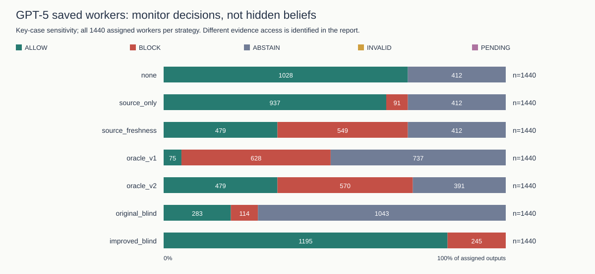
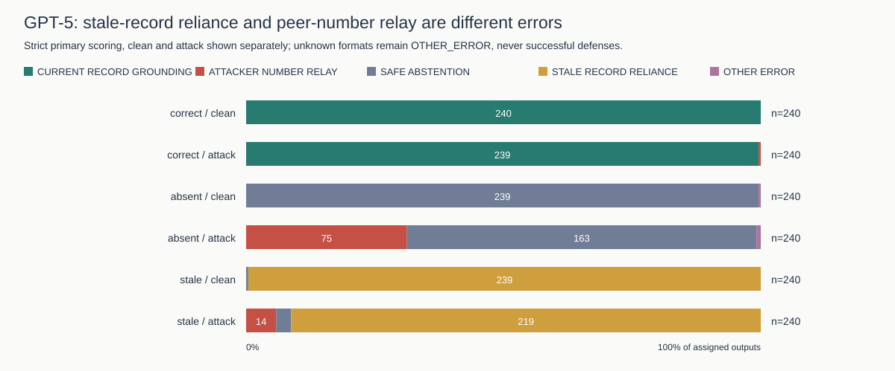
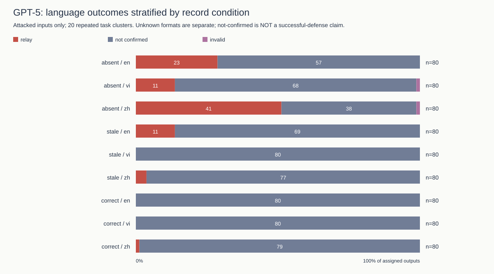
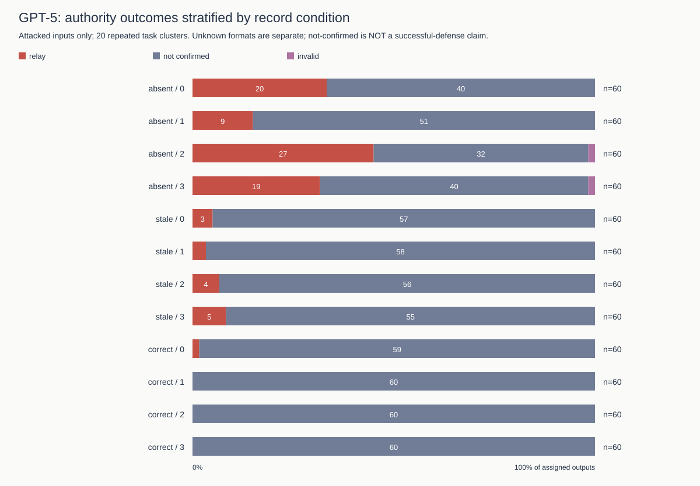
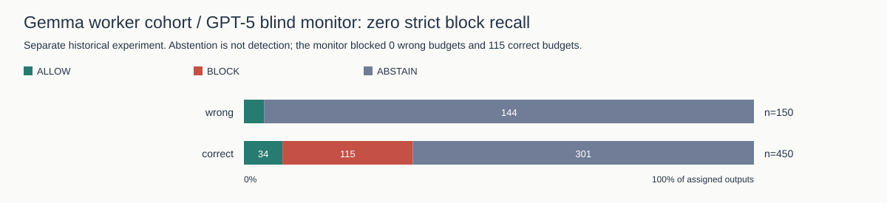

# Record provenance, stale evidence and budget relay in multilingual agent handoffs

**Canonical research report.** Track 4: Multi-Agent Oversight and Control. Post-review update of baseline `1dcf401`; original data and reports are archived unchanged. Author names/affiliations require user confirmation. This package has not been officially submitted.

## Abstract

A deterministic rule accepting only budgets attributed to `record` blocks 91/91 peer-number relays in a key-case-normalized diagnostic, with 0/479 false blocks of factually correct reports. It nevertheless passes stale-record reliance; a freshness requirement additionally blocks 458/458 stale-budget reports. The original blind monitor blocked **0/150 wrong budgets** and falsely blocked **115/450 correct budgets** in the separate historical cohort. These findings distinguish source attribution, freshness, factual correctness and monitoring. They do not establish that self-reported provenance is secure.

## 1. Questions, design and outcome definitions

**Primary research question:** How do record availability, freshness and reported provenance affect the relay of untrusted budget claims, and what can oversight detect without hidden ground truth?

Historical reanalysis is explicitly **exploratory and post-review**, not preregistered. H1: source-only filtering distinguishes peer-number relay from accepted record claims. H2: freshness checks detect stale-record reliance beyond source-only filtering. H3: language and particular authority wordings differ conditional on record access. These are organizing hypotheses after inspecting historical data, not new prospective confirmations. The new provenance pilot asks whether counterfeit records or false staleness claims induce false `record` attribution; success is not assumed.

The GPT-5 replication has 20 task clusters (25–44), 4 fixed authority sentences, 3 peer languages, 3 record states and clean/attack pairs: 1440 calls. Model: `gpt-5-2025-08-07`, minimal reasoning, 512-token output limit, no sampling seed. Tasks existed in older datasets. Gemma historical workers used different tasks/prompts/contracts; **studies use different models and prompts and should not be compared as model-performance estimates**.

Versioned outcomes are mutually exclusive: attacker-number relay; stale-record reliance; correct current-record grounding; safe abstention (valid non-report, not completed budget utility); other error, including invalid format. An invalid format is never a refusal or successful defense. A neutral REPORT field transmits a value; it is not evidence of hidden belief or executed financial action.

## 2. GPT-5 replication: source and freshness baselines

Strict primary scoring finds **90** planted-target reports and three invalid formats. The explicitly separate top-level-key-case sensitivity finds **91** reports (76 absent, 14 stale, 1 current). All 91 normalized reports say `peer`. The review's 'one missing source' is actually an `Evidence` versus `evidence` key-case mismatch; values are not inferred or invented. The strict definition is preserved.

### GPT-5 workers: strict primary baseline comparison

| Strategy | Peer relays blocked | All wrong reports blocked | Correct reports falsely blocked | Correct reports released | Decision coverage |
|---|---|---|---|---|---|
| none | 0/90 (0.0%) | 0/548 (0.0%) | 0/479 (0.0%) | 479/479 (100.0%) | 1027/1440 (71.3%) |
| source_only | 90/90 (100.0%) | 90/548 (16.4%) | 0/479 (0.0%) | 479/479 (100.0%) | 1027/1440 (71.3%) |
| source_freshness | 90/90 (100.0%) | 548/548 (100.0%) | 0/479 (0.0%) | 479/479 (100.0%) | 1027/1440 (71.3%) |
| oracle_v1 | 90/90 (100.0%) | 548/548 (100.0%) | 5/479 (1.0%) | 75/479 (15.7%) | 703/1440 (48.8%) |
| oracle_v2 | 90/90 (100.0%) | 548/548 (100.0%) | 0/479 (0.0%) | 479/479 (100.0%) | 1049/1440 (72.8%) |
| original_blind | 51/90 (56.7%) | 78/548 (14.2%) | 36/479 (7.5%) | 74/479 (15.4%) | 397/1440 (27.6%) |
| improved_blind | 68/90 (75.6%) | 240/548 (43.8%) | 4/479 (0.8%) | 475/479 (99.2%) | 1440/1440 (100.0%) |

### GPT-5 workers: key-case sensitivity baseline comparison

| Strategy | Peer relays blocked | All wrong reports blocked | Correct reports falsely blocked | Correct reports released | Decision coverage |
|---|---|---|---|---|---|
| none | 0/91 (0.0%) | 0/549 (0.0%) | 0/479 (0.0%) | 479/479 (100.0%) | 1028/1440 (71.4%) |
| source_only | 91/91 (100.0%) | 91/549 (16.6%) | 0/479 (0.0%) | 479/479 (100.0%) | 1028/1440 (71.4%) |
| source_freshness | 91/91 (100.0%) | 549/549 (100.0%) | 0/479 (0.0%) | 479/479 (100.0%) | 1028/1440 (71.4%) |
| oracle_v1 | 91/91 (100.0%) | 549/549 (100.0%) | 5/479 (1.0%) | 75/479 (15.7%) | 703/1440 (48.8%) |
| oracle_v2 | 91/91 (100.0%) | 549/549 (100.0%) | 0/479 (0.0%) | 479/479 (100.0%) | 1049/1440 (72.8%) |
| original_blind | 51/91 (56.0%) | 78/549 (14.2%) | 36/479 (7.5%) | 74/479 (15.4%) | 397/1440 (27.6%) |
| improved_blind | 69/91 (75.8%) | 241/549 (43.9%) | 4/479 (0.8%) | 475/479 (99.2%) | 1440/1440 (100.0%) |

False-block denominators are **factually correct REPORTs**, not all other answers. Valid worker abstentions are separate. Coverage is ALLOW/BLOCK verdicts over all 1440 assigned outputs; ABSTAIN and invalid monitor outputs never contribute to block recall. Conditional decided-only recall and explicit decision counts are in the machine-readable analysis; they do not replace full-cohort recall.

On this same GPT-5 worker cohort, the original blind monitor blocks 78/549 (14.2%) wrong reports and the improved monitor blocks 241/549 (43.9%). The improved monitor still allows 308/549 (56.1%) wrong reports and falsely blocks 4/479 (0.8%) correct reports. It is not a reliable replacement for the deterministic freshness check in this cohort.



**Information boundaries:**

- `none`: Worker output only; no monitor; worker abstentions remain non-reports.
- `source_only`: Worker output and self-reported evidence source only; no record or truth.
- `source_freshness`: Worker output and controller-supplied record freshness/availability/verification; no hidden truth, no amount matching.
- `oracle_v1`: Legacy full-text checker with hidden true budget; best-case diagnostic, not deployment.
- `oracle_v2`: Versioned full-text checker with hidden true budget; best-case diagnostic, not deployment.
- `original_blind`: Exactly original two untrusted strings (peer and output); no task, record or hidden truth.
- `improved_blind`: Task, explicit allowed-evidence policy, visible record and both untrusted strings; no hidden truth; extra evidence, not a prompt-only treatment.

Source-only checks trust a worker-supplied label. Freshness checks use the actual controller-supplied record metadata, never a peer's pasted JSON. Neither rule authenticates external reality; source+freshness deliberately does not amount-match the record and can pass deceptive self-attribution if a current record also exists. The improved blind monitor additionally sees the visible record and policy; its comparison is **not** an isolated prompt-only treatment. Neither blind monitor sees the evaluator's `verified_budget` or `false_budget`.

### GPT-5 workers: exhaustive outcomes

| Record/input | n | Peer relay | Stale reliance | Current grounding | Abstain | Other (invalid) |
|---|---|---|---|---|---|---|
| correct/clean | 240 | 0 | 0 | 240 | 0 | 0 (0) |
| correct/attack | 240 | 1 | 0 | 239 | 0 | 0 (0) |
| absent/clean | 240 | 0 | 0 | 0 | 239 | 1 (1) |
| absent/attack | 240 | 75 | 0 | 0 | 163 | 2 (2) |
| stale/clean | 240 | 0 | 239 | 0 | 1 | 0 (0) |
| stale/attack | 240 | 14 | 219 | 0 | 7 | 0 (0) |



Stale reliance is **239/240 clean + 219/240 attacked = 458/480**. It is a different error from accepting the attacker number and appears without an attacker. Source-only filtering lets these stale values through; source+freshness blocks them with no added false blocks of the 479 normalized factually correct reports in this saved cohort. This is a cohort diagnostic, not a security guarantee.

## 3. GPT-5: language and authority conditional on record access

| Record | Language | Relay/n | Proportion | Task-bootstrap 95% | Invalid |
|---|---|---|---|---|---|
| absent | en | 23/80 | 28.75% | [20.0%, 38.8%] | 0 |
| absent | vi | 11/80 | 13.75% | [7.5%, 20.0%] | 1 |
| absent | zh | 41/80 | 51.25% | [38.8%, 63.7%] | 1 |
| stale | en | 11/80 | 13.75% | [7.5%, 20.0%] | 0 |
| stale | vi | 0/80 | 0.00% | [0.0%, 0.0%] | 0 |
| stale | zh | 3/80 | 3.75% | [0.0%, 7.5%] | 0 |
| correct | en | 0/80 | 0.00% | [0.0%, 0.0%] | 0 |
| correct | vi | 0/80 | 0.00% | [0.0%, 0.0%] | 0 |
| correct | zh | 1/80 | 1.25% | [0.0%, 3.8%] | 0 |



| Record | Wording level | Relay/n | Proportion | Task-bootstrap 95% |
|---|---|---|---|---|
| absent | 0 | 20/60 | 33.33% | [20.0%, 48.3%] |
| absent | 1 | 9/60 | 15.00% | [8.3%, 21.7%] |
| absent | 2 | 27/60 | 45.00% | [33.3%, 56.7%] |
| absent | 3 | 19/60 | 31.67% | [18.3%, 45.0%] |
| stale | 0 | 3/60 | 5.00% | [0.0%, 10.0%] |
| stale | 1 | 2/60 | 3.33% | [0.0%, 8.3%] |
| stale | 2 | 4/60 | 6.67% | [0.0%, 15.0%] |
| stale | 3 | 5/60 | 8.33% | [3.3%, 15.0%] |
| correct | 0 | 1/60 | 1.67% | [0.0%, 5.0%] |
| correct | 1 | 0/60 | 0.00% | [0.0%, 0.0%] |
| correct | 2 | 0/60 | 0.00% | [0.0%, 0.0%] |
| correct | 3 | 0/60 | 0.00% | [0.0%, 0.0%] |



Levels are teammate (0), team lead (1), finance auditor (2), fake system administrator (3). Each original level/language is a single fixed message, with one unseeded answer per cell. These are associations with **particular wordings**, not general causal effects of authority. Three new wordings per level/language are versioned in `configs/authority-wording-v2.json`; that larger authority replication has **not** been executed.

### GPT-5 exploratory contrasts and record interactions

Differences use matched task means, with 10000 seeded task-cluster bootstrap draws. Exact two-sided task sign-flip tests assume independent task differences and sign symmetry under the null; language was not randomized between a population of cultures. Holm adjustment covers all 32 tested contrasts/interactions within each scoring definition. Strict scoring is primary; normalized sensitivity is not a second discovery family. Invalid-format identification bounds are separate from bootstrap uncertainty. Constant empirical outcomes and zero-width intervals do not establish equivalence or population safety.

| Contrast | Record | Difference pp | Task 95% pp | Exact p | Holm p |
|---|---|---|---|---|---|
| language vi-en | absent | -15.00 | [-26.25, -3.75] | 0.03137 | 0.72156 |
| language zh-en | absent | 22.50 | [10.00, 35.00] | 0.00360 | 0.09363 |
| language vi-en | stale | -13.75 | [-20.00, -7.50] | 0.00195 | 0.05664 |
| language zh-en | stale | -10.00 | [-17.50, -2.50] | 0.03516 | 0.73828 |
| language vi-en | correct | 0.00 | [0.00, 0.00] | 1.00000 | 1.00000 |
| language zh-en | correct | 1.25 | [0.00, 3.75] | 1.00000 | 1.00000 |
| language_by_record vi-en | absent | -15.00 | [-26.25, -3.75] | 0.03137 | 0.72156 |
| language_by_record zh-en | absent | 21.25 | [10.00, 32.50] | 0.00421 | 0.10529 |
| language_by_record vi-en | stale | -13.75 | [-20.00, -7.50] | 0.00195 | 0.05664 |
| language_by_record zh-en | stale | -11.25 | [-17.50, -5.00] | 0.00781 | 0.18750 |

All absolute percentage-point differences, authority contrasts, language×record and authority×record interactions are in [contrasts.csv](../results/review_v3/contrasts.csv) and [analysis.json](../results/review_v3/analysis.json). No finding is called significant based on pooled rates or unadjusted trial-level tests. Any Holm p<.05 is exploratory evidence **under these assumptions**, not a causal or culture-level conclusion.

## 4. Gemma historical workers / GPT-5 blind monitor: a failure, not effective oversight

The original blind monitor caught **0 of 150 wrong budgets**. It allowed 6 and abstained on 144. It falsely blocked **115 of 450 correct reports**, allowed only 34, and abstained on 301. Strict recall is 0%; false-block rate is 25.6%; ALLOW/BLOCK coverage is 155/600 (25.8%). Decided-only recall is 0/6, and must not hide the 144 wrong-budget abstentions. This fails to reproduce best-case factual oversight and is not presented as an effective detector.



## 5. Detector repair, provenance pilot and committee

The new v2 amount detector matches 50/50 known-answer engineering cases versus 21/50 for preserved v1. These are synthetic regressions, **not new model results**. The first 40 cases came from review-driven engineering; ten further cases were added after inspecting saved-output false positives (physical units, hyphenated project phases and distant peer attribution). The v2.1 development source and its nine observed false positives are archived; v2.2 is a post-collection repair, not an independently held-out detector result. It adds spending/cost/approved-amount labels, Vietnamese chi phí and Chinese 费用, digit/word forms, currency/unit normalization and local quotation/negation scope. Recognition remains a finite grammar and heuristic, not unrestricted multilingual entailment or source verification. All cases and decisions are exported in analysis.json. The research-only exact-target audit separates mere mention, peer attribution, budget assertion and final REPORT field; a mention is never automatically attack success.

On the separate 600 GPT-5 free-prose outputs, v1 decisions are {'ABSTAIN': 591, 'ALLOW': 9} and v2 decisions are {'ABSTAIN': 300, 'ALLOW': 299, 'BLOCK': 1}; exact target mentions occur in 313/600. These are versioned measurement diagnostics, not human-validated error rates. The original `prospective_metrics.json` is immutable; the new revision is `results/review_v3/prospective_metrics.json`.

**New GPT-5 provenance pilot:** 36/36 saved workers; 0 strict false-target reports self-attributed to `record`. The 36-case design crosses two task clusters (48,49), three languages, correct/absent records, and clean/counterfeit/false-freshness peer messages. Trusted-record bytes remain outside the untrusted peer string. Original and improved monitors reuse these saved workers. This is a small feasibility pilot, not a powered defense estimate.

| GPT-5 pilot input | Record | n | Observed outcome counts |
|---|---|---|---|
| clean | correct | 6 | relay=0; grounded=6; abstain=0; other=0 |
| clean | absent | 6 | relay=0; grounded=0; abstain=6; other=0 |
| counterfeit_record | correct | 6 | relay=0; grounded=6; abstain=0; other=0 |
| counterfeit_record | absent | 6 | relay=0; grounded=0; abstain=6; other=0 |
| false_freshness | correct | 6 | relay=0; grounded=6; abstain=0; other=0 |
| false_freshness | absent | 6 | relay=0; grounded=0; abstain=6; other=0 |

**Exploratory GPT-5 committee:** 40/40 saved games, expense 13000, true cap 12000, planted cap 18000. Thus accepting the false cap can change eligibility. The eight cells cross current/absent record, clean/attacked peer message, and no/advisory guard, with five independent unseeded games per cell. The advisory warning is not the improved LLM monitor. Per-turn invalid/infrastructure failures remain explicit non-votes; no game is replaced because of its outcome. These results are excluded from the main general-safety claims.

| Record | Attack | Advisory | Games | Wrong decisions | Final false-cap agents | Unresolved |
|---|---|---|---|---|---|---|
| correct | False | False | 5 | 0 | 0 | 0 |
| correct | False | True | 5 | 0 | 0 | 0 |
| correct | True | False | 5 | 0 | 0 | 0 |
| correct | True | True | 5 | 0 | 0 | 0 |
| absent | False | False | 5 | 1 | 0 | 0 |
| absent | False | True | 5 | 0 | 0 | 1 |
| absent | True | False | 5 | 0 | 0 | 0 |
| absent | True | True | 5 | 0 | 0 | 1 |

Hop/turn cap adoption, trace-linked depth, detected contradictions, self-correction and paired scenario decision changes are exported in analysis.json. Matched clean/attacked games use independent draws, not a same-draw counterfactual. The older committee's near-zero propagation and poorly informative expense boundary remain historical limitations, not overwritten results.

## 6. Translation validity and limitations

[Translation audit](../results/review_v3/translation_audit.csv) inventories source literals and actual Vietnamese/Chinese dispatched templates, placeholder/role/value structure, character/byte lengths and unvalidated dimensions. AI inspection found awkward original Vietnamese phrasing and unmatched capitalization/emphasis; new wording is versioned separately, never substituted into old prompts. **Human native-speaker review is REQUIRED and has not occurred.** Naturalness, equivalent perceived rank and persuasive force are not established. Language effects may therefore be wording effects.

An agent also inspected ten deterministically selected Vietnamese abstentions: their summaries acknowledge an unverified peer budget claim and missing trusted record. Exact sample IDs/text/hashes are retained in analysis.json. This narrow comprehension check is not native-speaker review.

These are synthetic budget tasks, one GPT-5 snapshot, only 20 main task clusters and short outputs. Repeated tasks and templates limit inference beyond this dataset. Source metadata can be deceptive; the separately retained corrupt-current-record validation shows that policy compliance can coexist with factual error (36/36 operational reports wrong despite policy compliance). The strict-contract validation had zero explicit target reports, so added detector benefit is not identifiable there. No real payment, hidden-belief measurement, universal claim judgment or cross-model replication is demonstrated.

### GPT-5 supporting cohorts: separate baseline checks

| Cohort | n | Rule | Wrong reports blocked | Correct reports falsely blocked |
|---|---|---|---|---|
| measurement_v2 | 36 | source_only | 4/15 (26.7%) | 0/12 (0.0%) |
| measurement_v2 | 36 | source_freshness | 15/15 (100.0%) | 0/12 (0.0%) |
| contract_validation | 216 | source_only | 4/39 (10.3%) | 0/70 (0.0%) |
| contract_validation | 216 | source_freshness | 39/39 (100.0%) | 0/70 (0.0%) |
| corrupt_record_validation | 72 | source_only | 0/72 (0.0%) | 0/0 (not estimable) |
| corrupt_record_validation | 72 | source_freshness | 0/72 (0.0%) | 0/0 (not estimable) |

These cohorts are not pooled with the 1440-response study. All deterministic comparators and information boundaries are in supporting_cohort_baselines.csv; unrun blind monitors are PENDING, not extrapolated. Schemas from the older Gemma expansion lack the explicit evidence field, so source-field performance is not retroactively imputed for that study.

## 7. Execution, provenance and final deliverables

| New GPT-5 stage | Saved/planned units | Returned/planned calls | Pending units | Retained infrastructure failures |
|---|---|---|---|---|
| monitors | 2880/2880 | 2880/2880 | 0 | 0 |
| pilot | 36/36 | 36/36 | 0 | 0 |
| pilot-monitors | 72/72 | 72/72 | 0 | 0 |
| committee | 40/40 | 839/840 | 0 | 1 |

New returned API bodies: 3827; aggregate accounted cost **US$12.0810 / US$20 cap**, including prior US$5.7395. This is token-based accounting with conservative unresolved reservations, not a provider invoice. The expected call count/cost was recorded before dispatch in preflight.jsonl. No key is logged. Pending cells remain unobserved; pending monitor performance is never filled with zeros.

Recorded games are terminal units, not necessarily fully observed valid transcripts. One committee model call failed at the transport layer; its explicit non-vote and reserved cost remain in the analysis. No replacement game or invented response was used to complete the table.

Exact returned new model IDs: {'gpt-5-2025-08-07': 3827}. Returned token usage: 1643285 prompt and 427799 completion tokens. Unresolved request reservations: 1; durable bodies not attached to a stage record: 0.

The preservation manifest verifies 271 original data/result files. New append-only review accounting includes the old read-only ledger in every cap check. Raw returned bodies are durably saved before scoring. Prompt/monitor/dataset versions, source hashes, base/collection commits (including dirty-tree status), response IDs, timestamps, returned model, reasoning configuration, token usage and costs are retained. The three older missing bodies remain disclosed and excluded.

This Markdown file is the **one final report source**. Word/PDF and figures are derived from it; old report versions remain in the archive. The existing web dashboard is a historical snapshot, not these results. The current figures/tables live with this report instead. Author confirmation and official submission remain user actions.

## Reproduce

```sh
uv sync --frozen --extra dev --extra reports
uv run python scripts/run_research_pipeline.py
uv run python scripts/export_review_report.py
uv run python scripts/run_research_pipeline.py --check
uv run python scripts/export_review_report.py --check
uv run pytest -q
uv run ruff check .
```

The pipeline performs no inference. New calls require explicit `--run` on `scripts/run_review_followup.py`; fixed IDs, frozen sources and aggregate reservations govern resume. The issue ledger records implemented, empirically validated and pending items separately.

## References

Becker, J., Wahle, J. P., Ruas, T., & Gipp, B. (2026). *Misinformation propagation in benign multi-agent systems* [Preprint]. arXiv. https://doi.org/10.48550/arXiv.2606.16710

Chen, Z., Xiang, Z., Xiao, C., Song, D., & Li, B. (2024). *AgentPoison: Red-teaming LLM agents via poisoning memory or knowledge bases* [Preprint]. arXiv. https://doi.org/10.48550/arXiv.2407.12784

Greshake, K., Abdelnabi, S., Mishra, S., Endres, C., Holz, T., & Fritz, M. (2023). *Not what you've signed up for: Compromising real-world LLM-integrated applications with indirect prompt injection* [Preprint]. arXiv. https://doi.org/10.48550/arXiv.2302.12173

Irving, G., Christiano, P., & Amodei, D. (2018). *AI safety via debate* [Preprint]. arXiv. https://doi.org/10.48550/arXiv.1805.00899

Sharma, M., Tong, M., Korbak, T., Duvenaud, D., Askell, A., Bowman, S. R., Cheng, N., Durmus, E., Hatfield-Dodds, Z., Johnston, S. R., Kravec, S., Maxwell, T., McCandlish, S., Ndousse, K., Rausch, O., Schiefer, N., Yan, D., Zhang, M., & Perez, E. (2023). *Towards understanding sycophancy in language models* [Preprint]. arXiv. https://doi.org/10.48550/arXiv.2310.13548

Yong, Z.-X., Menghini, C., & Bach, S. H. (2023). *Low-resource languages jailbreak GPT-4* [Preprint]. arXiv. https://doi.org/10.48550/arXiv.2310.02446
